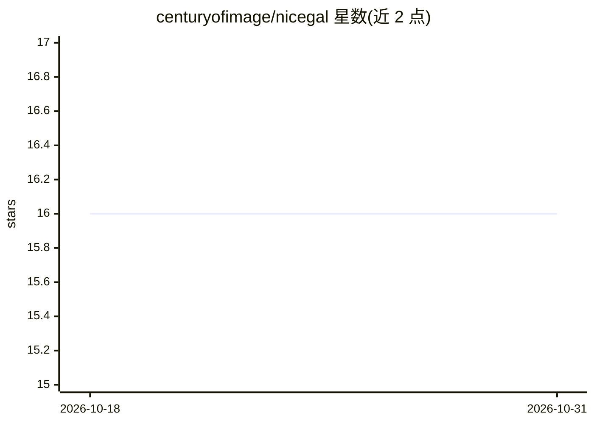

# centuryofimage/nicegal

⭐ 16 · TypeScript · MIT · 推送 2026-10-28 · [GitHub](https://github.com/centuryofimage/nicegal) · 个人维护

**桌面照片视频浏览器：用 CLIP/DINOv3 在杂乱文件夹中视觉搜索**

Electron 桌面图库应用，浏览本地照片与视频，支持三种手机风格布局、日期导航、视频播放与远程网页访问。核心机制：CLIP 视觉搜索（文字描述、示例图或两者组合，可用多图）、可选 PaddleOCR 图内文字搜索、DINOv3 匹配区域可视化；索引用 DirectML/WebGPU 调用 GPU，可切换 OpenVINO。搜索模型首次使用时下载，数据本地处理、无遥测。提供 Linux Flatpak 与发布版下载，前端 MIT、后端 AGPL-3.0。

## 筛选速览

| 维度 | 判定 | 备注 |
|---|---|---|
| AI 角色 | `ai-enhanced` | 去掉 AI 部分产品仍成立 |
| 许可风险 | `permissive` | MIT |
| 部署形态 | `None` |  |
| 模型依赖 | — | README 未给出锁定关系 |
| 硬件要求 | — | 无带数字的原话,不猜 |
| 安装摩擦 | `low` | 无编译、无系统依赖或容器化 |
| 成熟度 | — | 结构信号不足 |

## 能力要点

- CLIP 视觉搜索：描述、示例图或组合，支持多图
- 可选 PaddleOCR 图内文字搜索与 DINOv3 匹配区域可视化
- GPU 索引（DirectML/WebGPU），可切换 OpenVINO/CPU
- 本地处理、无遥测，可通过浏览器或手机远程访问

## 适用场景

- 在巨大的未整理下载文件夹里找照片或视频
- 用文字描述或示例图片搜本地图片库
- 搜索图片内的文字内容

## 场景标签

`语义搜索` `OCR` · 领域:知识与检索

## 证据(README 行号)

> L7: it supports visually searching photos and videos with CLIP. you can also search with an image. search indexing uses 
> L15: you can also search by file name, or enable OCR (PaddleOCR) to search the text inside images.
> L5: nicegal is a super fast desktop gallery for photos and videos. it has powerful search features, and is designed to h

## 星数曲线

2026-10-18 16 → 2026-10-31 16（+0）

---
*卡片 v1 · prompt 1.4 · 生成 2026-10-30 · 置信度 high · 依据 README sha `14bada19749b` · [字段定义](../../DATASET.md)*
