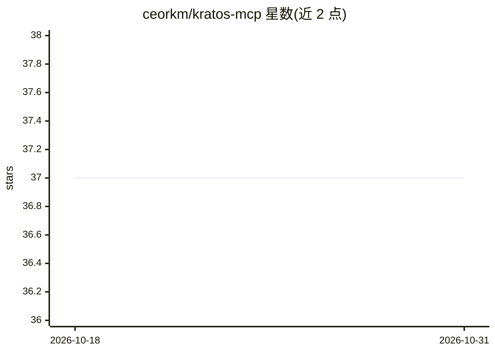

# ceorkm/kratos-mcp

⭐ 37 · TypeScript · MIT · 推送 2026-03-16 · [GitHub](https://github.com/ceorkm/kratos-mcp) · [官网](https://www.npmjs.com/package/kratos-mcp) · 个人维护

**给 AI 编程工具的 MCP 记忆服务器，跨会话保存项目知识**

一个 MCP 协议服务器，为 Claude、Cursor 等 AI 编程工具提供项目级持久记忆：每个项目独立 SQLite 数据库（FTS5 全文检索），自动检测项目，提供 12 个工具覆盖记忆存储/语义检索/删除、PII 与密钥安全扫描、项目切换与存储路径迁移。所有数据留在本地。注意：README 声明本仓库已转为 legacy，维护方向转移至独立 CLI 仓库 kratos-cli，现有记忆数据可直接沿用。

## 筛选速览

| 维度 | 判定 | 备注 |
|---|---|---|
| AI 角色 | `ai-ecosystem` | LLM/agent 周边工具 |
| 许可风险 | `permissive` | MIT |
| 部署形态 | `library` | 以包/库形式分发 |
| 模型依赖 | locked-api |  |
| 硬件要求 | — | 无带数字的原话,不猜 |
| 安装摩擦 | `low` | 无编译、无系统依赖或容器化 |
| 成熟度 | — | 结构信号不足 |

## 能力要点

- 每项目独立 SQLite + FTS5 存储，自动检测项目（git/package.json/目录）
- 12 个 MCP 工具：记忆管理 7 个、安全扫描 1 个、项目管理 3 个、系统状态 1 个
- security_scan 在保存前扫描文本中的 PII 与密钥
- 兼容任意 MCP 工具：Claude Code、Cursor、Windsurf、Cline、Amazon Q、JetBrains AI 等

## 适用场景

- 让 Claude Code 或 Cursor 记住项目架构、编码规范和历史决策
- 多项目间隔离并切换 AI 记忆数据
- 本地保存 AI 编程上下文，数据不外发

## 场景标签

`Agent 记忆` · 领域:Agent 开发

## 证据(README 行号)

> L50: Works with Claude, Cursor, Windsurf, Continue—any MCP-compatible tool.
> L118: Kratos works with any tool supporting the Model Context Protocol. The general format is:
> L150: |`memory_save`|Store important project knowledge with tags, paths, and importance levels|

## 星数曲线

2026-10-18 37 → 2026-10-31 37（+0）

---
*卡片 v1 · prompt 1.4 · 生成 2026-10-25 · 置信度 high · 依据 README sha `22d6e7c42efd` · [字段定义](../../DATASET.md)*
