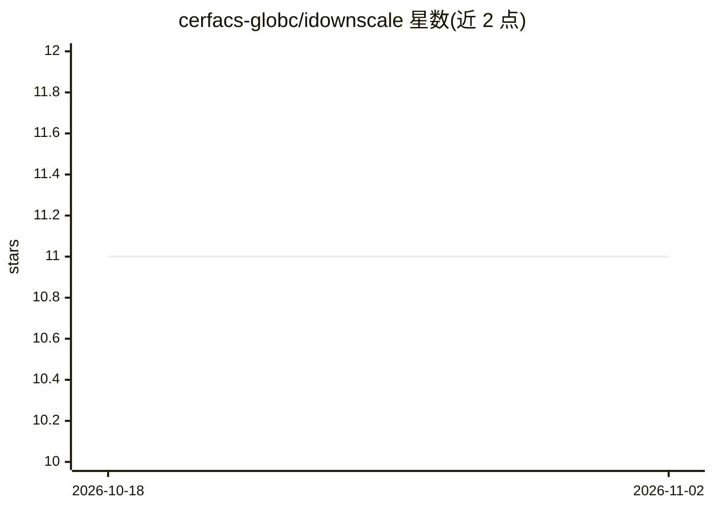

# cerfacs-globc/idownscale

⭐ 11 · Python · Apache-2.0 · 推送 2026-08-26 · [GitHub](https://github.com/cerfacs-globc/idownscale) · 组织维护

**科研用气候降尺度工具：从粗分辨率 GCM 场生成公里级气候产品**

CERFACS 在 IRISCC 项目下开发的气候降尺度机器学习工作流：读取约 150 km 的逐日 GCM 场（默认近地面温度），通过 U-Net 类神经网络训练与推理生成公里级区域气候产品。流程包含数据预处理（守恒插值、地形通道）、CDF-t 偏差校正（perfect prognosis 框架）、训练（PyTorch Lightning 风格 checkpoint）、长期推理（predict_loop 输出 netCDF）与逐日/逐月/VALUE 式评估指标和可视化。设计上围绕温度变量，可配置扩展到降水、湿度、风、辐射等；GPU 仅在训练与推理循环环节需要，其余步骤可 CPU 运行。

## 筛选速览

| 维度 | 判定 | 备注 |
|---|---|---|
| AI 角色 | `ai-native` | 本体是模型或模型工具 |
| 许可风险 | `permissive` | Apache-2.0 |
| 部署形态 | `None` |  |
| 模型依赖 | — | README 未给出锁定关系 |
| 硬件要求 | — | 无带数字的原话,不猜 |
| 安装摩擦 | `low` | 无编译、无系统依赖或容器化 |
| 成熟度 | — | 结构信号不足 |

## 能力要点

- 端到端工作流：预处理→偏差校正→训练→长期推理→评估
- CDF-t 偏差校正与 perfect prognosis 框架
- 支持 ERA5/CNRM-CM6-1/ALADIN RCM 多数据源输入
- 逐日/逐月/VALUE 式指标与诊断图输出

## 适用场景

- 把粗分辨率气候模拟降尺度为公里级区域投影产品
- 对未来情景（如 ssp585）做长期推理并生成 netCDF 预测
- 对比预测与 GCM/RCM 的未来趋势并计算评估指标

## 场景标签

`科研工具` · 领域:学习与行业

## 证据(README 行号)

> L5: The **IRISCC** project is part of a consortium of European research infrastructures of which CERFACS is a member. It
> L156: In the ‘perfect prognosis’ approach employed by Soares et al. (2024) and Vrac and Vaittinada Ayar (2017), the neur

## 星数曲线

2026-10-18 11 → 2026-11-02 11（+0）

---
*卡片 v1 · prompt 1.4 · 生成 2026-11-02 · 置信度 high · 依据 README sha `07cfd28aecbf` · [字段定义](../../DATASET.md)*
