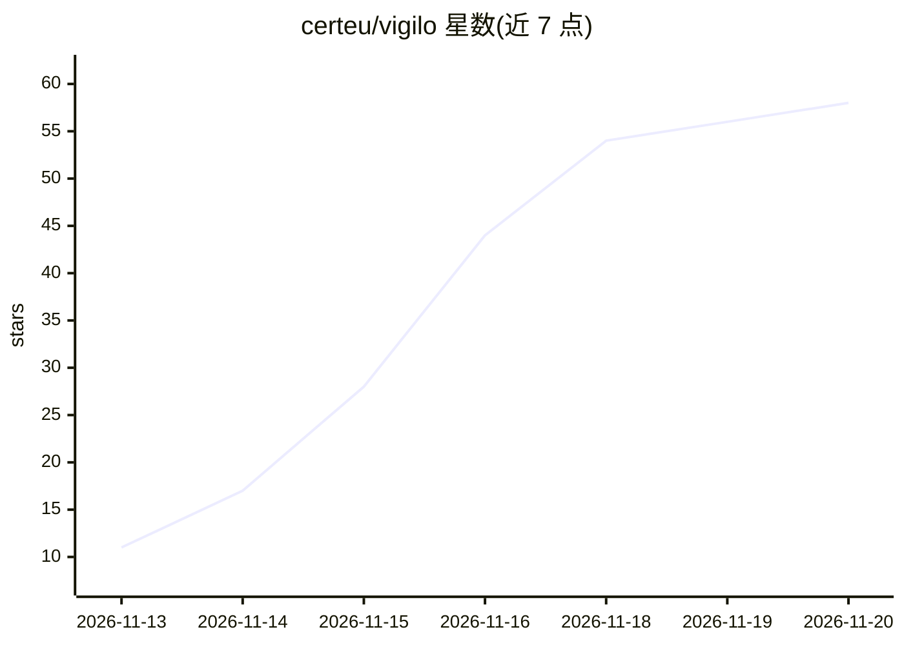

# certeu/vigilo

⭐ 58 · Python · EUPL-1.2 · 推送 2026-11-19 · [GitHub](https://github.com/certeu/vigilo) · 组织维护

**安全团队对自有 Web 应用跑可复现的 AI 渗透测试流水线**

CERT-EU 开发的 AI 驱动渗透测试流水线：专用 agent 分别负责侦察、按漏洞类别（注入/XSS/认证/SSRF/GraphQL/供应链等）并行发现、利用取证，并由对抗性 critic 复核每条 finding 后生成带证据的报告；白盒模式还按每条确认漏洞生成修复分支与 merge request。以 Docker Compose 部署的多用户 Web 平台（React UI + FastAPI + Temporal + Postgres）或命令行两种方式运行，需要配置一个 LLM 后端凭证（Anthropic/Bedrock/Foundry/Codex 等）才能执行扫描。灰盒模式目前仅限 CLI。

## 筛选速览

| 维度 | 判定 | 备注 |
|---|---|---|
| AI 角色 | `ai-native` | 本体是模型或模型工具 |
| 许可风险 | `viral` | EUPL-1.2 |
| 部署形态 | `self-host` | docker 或自建部署 |
| 模型依赖 | locked-api |  |
| 硬件要求 | — | 无带数字的原话,不猜 |
| 安装摩擦 | `low` | 无编译、无系统依赖或容器化 |
| 成熟度 | — | 结构信号不足 |

## 能力要点

- 专用 agent 按漏洞类别并行发现，对抗性 critic 复核每条 finding
- 白盒模式：读取源码并按每条确认漏洞生成修复分支与 merge request
- 灰盒模式：无源码，输出 WAF 规则、日志签名与 SIEM 查询等检测建议
- Web 平台以 Docker Compose 一键部署（Traefik TLS + Temporal + Postgres）

## 适用场景

- 对我们团队维护的代码仓库跑可复现的自动化渗透测试
- 测试无法获取源码的第三方 SaaS/供应商产品并产出蓝队检测建议
- 按确认漏洞逐条接收修复补丁分支用于评审合并

## 场景标签

`网络安全` · 领域:学习与行业

## 证据(README 行号)

> L3: **AI-powered penetration-testing pipeline.** Specialized agents run a full vulnerability
> L8: Vigilo was built by **CERT-EU** so security teams can run repeatable, agent-driven pentests

## 星数曲线

2026-11-13 11 → 2026-11-20 58（+47）

---
*卡片 v1 · prompt 1.4 · 生成 2026-11-18 · 置信度 mid · 依据 README sha `c73ad322f37b` · [字段定义](../../DATASET.md)*
