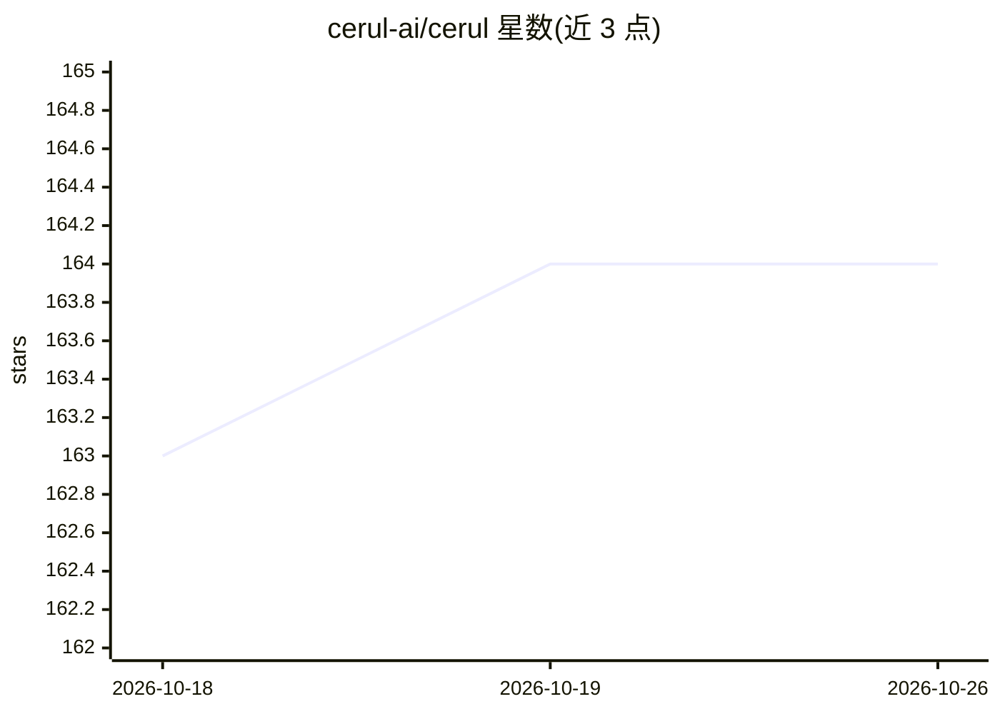

# cerul-ai/cerul

⭐ 164 · Rust · Apache-2.0 · 推送 2026-10-22 · [GitHub](https://github.com/cerul-ai/cerul) · [官网](https://cerul.ai) · 组织维护 · 中文 README

**用自有模型端点把本地视频变成可搜索库的 CLI**

Rust 编写的开源视频处理核心与命令行工具：将本地视频文件夹索引为可搜索库，支持按语义句子或参考图片搜索、语音转录与本地嵌入式 OCR 识别屏幕文字、导出剪辑片段与结构化语义标注，并缓存已完成工作以便中断后恢复。模型调用使用用户自有的 API 端点（默认 Gemini 嵌入与转录，OCR 本地运行无需 API），转录可切换 Groq、OpenAI 或 OpenAI 兼容服务。附带机器人工作流（LeRobot 数据集）。支持 macOS Apple Silicon 与 Linux x86_64（Ubuntu 24.04+）。

## 筛选速览

| 维度 | 判定 | 备注 |
|---|---|---|
| AI 角色 | `ai-native` | 本体是模型或模型工具 |
| 许可风险 | `permissive` | Apache-2.0 |
| 部署形态 | `None` |  |
| 模型依赖 | — | README 未给出锁定关系 |
| 硬件要求 | — | 无带数字的原话,不猜 |
| 安装摩擦 | `low` | 无编译、无系统依赖或容器化 |
| 成熟度 | — | 结构信号不足 |

## 能力要点

- 按句子或参考图像的多模态语义搜索
- 语音转录 + 本地嵌入式 OCR 识别屏幕文字
- 用户自有模型端点，默认 Gemini，OCR 无需 API 调用
- Sidecar 文件保存转录/标注/向量，可不经模型调用重建索引
- 面向 agent 的技能导出（cerul skill --install）与 LeRobot 机器人工作流

## 适用场景

- 用一句话描述找到视频里的时刻并保存剪辑
- 在机器人演示数据（LeRobot）中检索和标注片段
- 对本地视频库做可审计的转录与屏幕文字索引

## 场景标签

`语义搜索` `RAG` `OCR` `多模态` · 领域:知识与检索

## 证据(README 行号)

> L23: Cerul turns local videos into a searchable library. Describe a moment, find text
> L28: - **Find speech and screen text.** Transcription plus local, embedded OCR.
> L34: Cerul is a command-line tool for searching videos and saving clips. The download

## 星数曲线

2026-10-18 163 → 2026-10-26 164（+1）

---
*卡片 v1 · prompt 1.4 · 生成 2026-10-22 · 置信度 high · 依据 README sha `82652cac20d6` · [字段定义](../../DATASET.md)*
