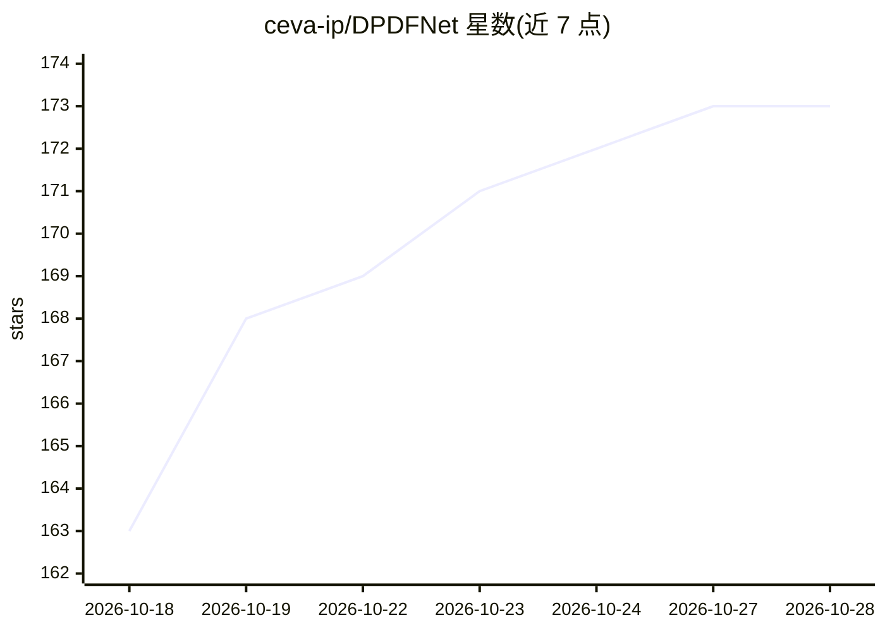

# ceva-ip/DPDFNet

⭐ 174 · Python · Apache-2.0 · 推送 2026-10-20 · [GitHub](https://github.com/ceva-ip/DPDFNet) · 组织维护

**实时语音增强模型库：为录音/直播/边缘设备去噪**

基于双路径 RNN 的流式语音增强模型 DPDFNet，提供 8/16/48 kHz 多档预训练模型（参数量 2.3M-3.6M），以 pip 包形式提供 CLI、Python API 与保持 RNN 状态的 StreamEnhancer 实时流式接口，推理后端含 ONNX 与 TFLite，支持从 checkpoint 导出 ONNX。首个增强输出延迟约 20ms，后续每块约 10ms 额外延迟。模型文件不在仓库内，需从 Hugging Face 下载；提供实时麦克风演示、评测脚本（PESQ/STOI/SI-SNR/DNSMOS/NISQA）与 Gradio 在线演示。面向科研、音频应用与边缘设备开发者。

## 筛选速览

| 维度 | 判定 | 备注 |
|---|---|---|
| AI 角色 | `ai-native` | 本体是模型或模型工具 |
| 许可风险 | `permissive` | Apache-2.0 |
| 部署形态 | `library` | 以包/库形式分发 |
| 模型依赖 | — | README 未给出锁定关系 |
| 硬件要求 | — | 无带数字的原话,不猜 |
| 安装摩擦 | `low` | 无编译、无系统依赖或容器化 |
| 成熟度 | — | 结构信号不足 |

## 能力要点

- 8/16/48 kHz 多档预训练模型，TFLite 尺寸 8.5-18.7 MB
- StreamEnhancer 流式处理，任意块长，约 20ms 首输出延迟
- ONNX/TFLite 推理与从 checkpoint 的 ONNX 导出脚本
- 实时麦克风演示含噪声抑制级别控制与 AGC

## 适用场景

- 清理录音或直播中的带噪语音
- 在边缘设备上做低延迟噪声抑制
- 流式通话场景逐块增强音频
- 用 DPDFNet EvalSet 做语音增强评测对比

## 场景标签

 · 领域:音频/语音处理

## 证据(README 行号)

> L3:  Real-time speech enhancement for recordings, live streams, and edge devices.
> L80: `StreamEnhancer` processes audio chunk-by-chunk, preserving RNN state across
> L172: - Gradio application: https://huggingface.co/spaces/Ceva-IP/DPDFNetDemo

## 星数曲线

2026-10-18 163 → 2026-10-28 173（+10）

---
*卡片 v1 · prompt 1.4 · 生成 2026-10-22 · 置信度 high · 依据 README sha `2f15bd5ebb4a` · [字段定义](../../DATASET.md)*
