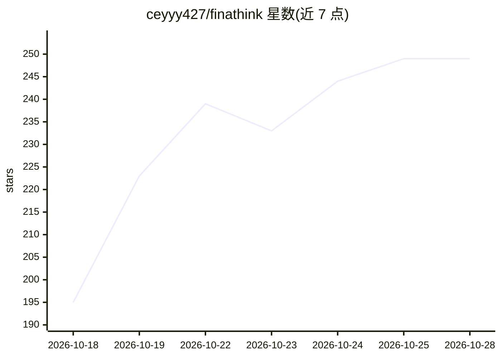

# ceyyy427/finathink

⭐ 249 · Python · MIT · 推送 2026-10-28 · [GitHub](https://github.com/ceyyy427/finathink) · [官网](https://github.com/ceyyy427/finathink) · 个人维护 · 中文 README

**本地优先的金融量化研究工作台：点时数据、因子回测与纸面组合**

Python 实现的本地金融研究与量化策略工作台，将用户数据接入、五类分析师多代理并行研究、因子提案、回测与 OOS 检验、确定性风险检查、long-only 纸面组合和成本滑点模拟组织成可追溯流程，输出结构化记录与可离线打开的 HTML 报告。每阶段有运行 ID、输入输出指纹与 checkpoint，相同 fixture 输入可重放并得到稳定指纹。声明不做实盘交易与券商下单；真实供应商与生产部署标记为未验证。

## 筛选速览

| 维度 | 判定 | 备注 |
|---|---|---|
| AI 角色 | `ai-enhanced` | 去掉 AI 部分产品仍成立 |
| 许可风险 | `permissive` | MIT |
| 部署形态 | `library` | 以包/库形式分发 |
| 模型依赖 | — | README 未给出锁定关系 |
| 硬件要求 | — | 无带数字的原话,不猜 |
| 安装摩擦 | `low` | 无编译、无系统依赖或容器化 |
| 成熟度 | — | 结构信号不足 |

## 能力要点

- 五类分析师并行 + ResearchManager 证据汇总的多代理研究流程
- 因子 DSL 模板、训练/验证/隐藏 OOS、IC/ICIR/换手/衰减确定性排名
- 本地持久化队列支持幂等、租约、重试与崩溃恢复
- 自包含 HTML 报告，离线无 JavaScript 可读，含状态墙与 manifest 指纹

## 适用场景

- 个人量化研究：从数据接入到回测、风控、纸面组合的完整复盘
- 量化学习：as-of 学习提案与可重放的确定性实验对比
- 策略验证：PIT 检查、流动性/集中度/回撤/压力情景的风险审查

## 场景标签

`金融量化` `科研工具` · 领域:学习与行业

## 证据(README 行号)

> L32: - 并行运行基本面、技术、情绪、新闻和学习分析师。
> L35: - 可使用离线驱动、用户配置的兼容模型接口和 Codex handoff 合同。
> L39: - 将自然语言假设映射到固定 DSL 模板和受控因子提案。

## 星数曲线

2026-10-18 195 → 2026-10-28 249（+54）

---
*卡片 v1 · prompt 1.4 · 生成 2026-10-22 · 置信度 mid · 依据 README sha `a597e14b4342` · [字段定义](../../DATASET.md)*
