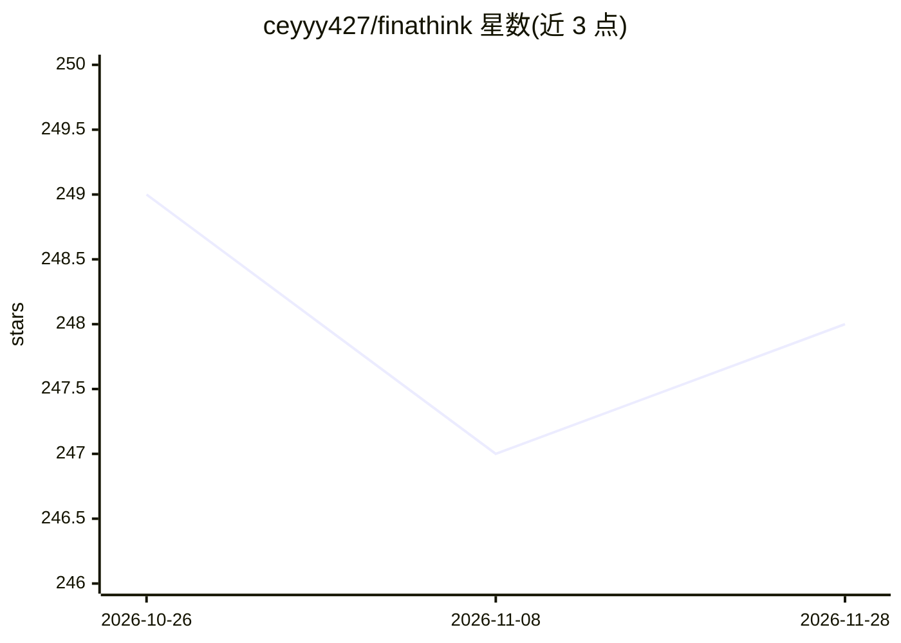

# ceyyy427/finathink

⭐ 248 · Python · MIT · 推送 2026-11-27 · [GitHub](https://github.com/ceyyy427/finathink) · [官网](https://github.com/ceyyy427/finathink) · 个人维护 · 中文 README

**个人金融研究工作台：可追溯的量化研究与组合分析**

将用户数据、证据、因子、回测、风险检查、纸面组合和学习记录组织为带运行 ID、输入输出指纹与 checkpoint 的可追溯研究流程，结果保存为结构化记录和可离线打开的 HTML 报告。包含五类分析师的多代理研究流程、162 张因子定义卡、80 条中文量化词条与 12 条学习路径、12 个冻结策略模板与风险规则。模型接口由用户自行配置，离线流程可直接运行；要求 Python 3.11+，本地安装后以 Web 界面运行。

## 筛选速览

| 维度 | 判定 | 备注 |
|---|---|---|
| AI 角色 | `ai-enhanced` | 去掉 AI 部分产品仍成立 |
| 许可风险 | `permissive` | MIT |
| 部署形态 | `library` | 以包/库形式分发 |
| 模型依赖 | — | README 未给出锁定关系 |
| 硬件要求 | — | 无带数字的原话,不猜 |
| 安装摩擦 | `low` | 无编译、无系统依赖或容器化 |
| 成熟度 | — | 结构信号不足 |

## 能力要点

- 每阶段带运行 ID、指纹与 checkpoint，相同 fixture 输入可重放得到稳定结果
- 多代理研究：基本面/技术/情绪/新闻/学习分析师并行，经理汇总带证据引用的观察
- 十类因子定义库（162 张来源卡、80 个公式）与 80 条中文量化词条、48 个手算示例
- 确定性风险检查、纸面组合与费用/滑点模拟，未通过检查的决策卡不可执行

## 适用场景

- 用自己接入的数据 API 做点时可核验的因子研究与回测
- 按中文学习路径学习量化概念并手算示例
- 复盘纸面组合表现并审批因子权重修改提案
- 冻结输入条件下比较策略两个版本的样本外净值

## 场景标签

`金融量化` `科研工具` · 领域:学习与行业

## 证据(README 行号)

> L45: - 选择自己的兼容模型接口，授权发送角色材料；五类分析师并行研究，经理汇总观察、分歧与待验证假设。模型观察与服务器计算结果分别留档，见模型材料研究指南。
> L49: - 本地离线角色流程可直接运行，研究问题与资源预算随任务留档。
> L56: - 可使用离线驱动、用户配置的兼容模型接口和 Codex handoff 合同。

## 星数曲线

2026-10-26 249 → 2026-11-28 248（-1）

---
*卡片 v1 · prompt 1.4 · 生成 2026-11-27 · 置信度 low · 依据 README sha `6f2f02cafd65` · [字段定义](../../DATASET.md)*
