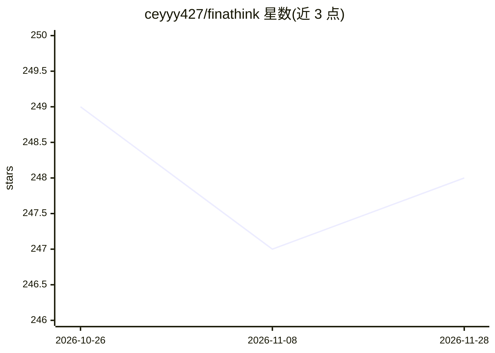

# ceyyy427/finathink

⭐ 248 · Python · MIT · 推送 2026-11-27 · [GitHub](https://github.com/ceyyy427/finathink) · [官网](https://github.com/ceyyy427/finathink) · 个人维护 · 中文 README

**本地优先的金融量化研究工作台：可追溯的点时研究与组合分析**

将用户数据、证据、因子、回测、风险检查、纸面组合和学习记录组织为可追溯的研究流程：用户自配模型接口供五类分析师（基本面/技术/情绪/新闻/学习）并行研究，研究经理汇总证据；因子实验支持 IC/ICIR、OOS、冻结测试与多重检验记录；策略账本覆盖费用、滑点与风险规则。结果保存为结构化记录和可离线打开的 HTML 报告，相同 fixture 输入可重放并得到稳定指纹。要求 Python 3.11+，pip 安装后本地运行。

## 筛选速览

| 维度 | 判定 | 备注 |
|---|---|---|
| AI 角色 | `ai-native` | 本体是模型或模型工具 |
| 许可风险 | `permissive` | MIT |
| 部署形态 | `library` | 以包/库形式分发 |
| 模型依赖 | — | README 未给出锁定关系 |
| 硬件要求 | — | 无带数字的原话,不猜 |
| 安装摩擦 | `low` | 无编译、无系统依赖或容器化 |
| 成熟度 | — | 结构信号不足 |

## 能力要点

- 五类分析师并行、研究经理汇总证据引用的多代理研究流程
- 点时（point-in-time）数据检查与输入输出指纹、checkpoint 可复现
- 十类因子定义库：162 张来源卡与 80 个公式，含 48 个手算示例的中文学习路径
- 自包含离线 HTML 报告，支持跨工作区导入复算

## 适用场景

- 把自有行情数据接入点时检查并生成带证据引用的研究报告
- 对策略想法做回测、样本外检验与稳健性评分
- 按中文学习路径学习量化概念并手算示例
- 对已发布策略在不同时间窗与费用假设下复算验证

## 场景标签

`金融量化` `科研工具` `多智能体` · 领域:Agent 开发

## 证据(README 行号)

> L5: Finathink 将用户提供的数据、证据、因子、量化检验、风险检查、纸面组合和学习记录组织成一条可追溯的研究流程。运行结果保存为结构化记录和可离线打开的 HTML 报告，适合个人研究、量化学习、策略复盘和多代理协作。
> L55: - 选择自己的兼容模型接口，授权发送角色材料；五类分析师并行研究，经理汇总观察、分歧与待验证假设。模型观察与服务器计算结果分别留档，见模型材料研究指南。
> L63: - 并行运行基本面、技术、情绪、新闻和学习分析师。

## 星数曲线

2026-10-26 249 → 2026-11-28 248（-1）

---
*卡片 v1 · prompt 1.4 · 生成 2026-11-28 · 置信度 mid · 依据 README sha `60e6caf6e50f` · [字段定义](../../DATASET.md)*
