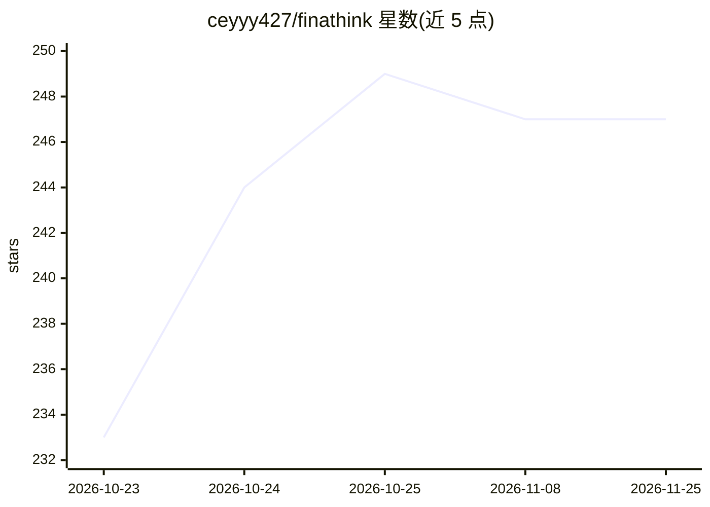

# ceyyy427/finathink

⭐ 247 · Python · MIT · 推送 2026-11-13 · [GitHub](https://github.com/ceyyy427/finathink) · [官网](https://github.com/ceyyy427/finathink) · 个人维护 · 中文 README

**本地优先的金融研究与量化策略工作台**

Finathink 将用户自有数据、证据、因子、量化检验、风险检查、纸面组合和学习记录组织成可追溯研究流程，运行结果保存为结构化记录与可离线打开的 HTML 报告。机制上提供五类分析师并行的多代理研究、受控因子提案与回测/OOS 检验、确定性风险检查与纸面账本，每阶段带运行 ID、输入输出指纹与 checkpoint，相同 fixture 输入可重放。面向个人研究者与量化学习者，需 Python 3.11+，以本地 Web 服务运行。

## 筛选速览

| 维度 | 判定 | 备注 |
|---|---|---|
| AI 角色 | `ai-ecosystem` | LLM/agent 周边工具 |
| 许可风险 | `permissive` | MIT |
| 部署形态 | `library` | 以包/库形式分发 |
| 模型依赖 | — | README 未给出锁定关系 |
| 硬件要求 | — | 无带数字的原话,不猜 |
| 安装摩擦 | `low` | 无编译、无系统依赖或容器化 |
| 成熟度 | — | 结构信号不足 |

## 能力要点

- 五类分析师并行的多代理研究与证据引用汇总
- 因子实验九步证据链：审计、语义、IC、回测、OOS、归档
- 本地持久化队列支持幂等、重试、checkpoint 与崩溃恢复
- 162 张固定来源卡与 80 个中文规范词条的知识库

## 适用场景

- 用自有数据 API 做可溯源的因子研究与回测
- 学习量化概念并通过手算示例自测
- 管理纸面组合并模拟费用、滑点与风险约束
- 多代理协作生成可离线阅读的研究报告

## 场景标签

`金融量化` `科研工具` `多智能体` · 领域:Agent 开发

## 证据(README 行号)

> L33: - 选择自己的兼容模型接口，授权发送角色材料；五类分析师并行研究，经理汇总观察、分歧与待验证假设。模型观察与服务器计算结果分别留档，见模型材料研究指南。
> L41: - 并行运行基本面、技术、情绪、新闻和学习分析师。
> L60: - 使用内部确定性量化网关执行回测和风险指标计算。

## 星数曲线

2026-10-23 233 → 2026-11-25 247（+14）

---
*卡片 v1 · prompt 1.4 · 生成 2026-11-25 · 置信度 low · 依据 README sha `b0e2cd481be2` · [字段定义](../../DATASET.md)*
