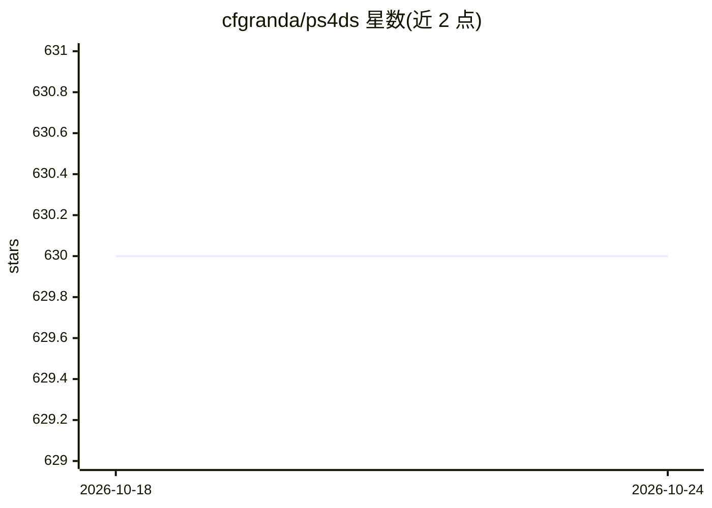

# cfgranda/ps4ds

⭐ 630 · Jupyter Notebook · 推送 2026-10-13 · [GitHub](https://github.com/cfgranda/ps4ds) · [官网](https://www.ps4ds.net/) · 个人维护

**数据科学概率统计教材的代码仓库与配套资源**

《Probability and Statistics for Data Science》一书的官方代码仓库。README 按章节列出各概念的 Python notebook 主题，覆盖概率、离散/连续变量、马尔可夫链、贝叶斯建模、假设检验、PCA 与低秩模型、回归与分类（含神经网络）等，每条注明所用真实数据集与对应统计概念。书籍描述称提供免费 preprint PDF、103 个 Python notebook（使用 23 个真实数据集）、118 个带幻灯片的视频及 200 道习题解答，均可在 ps4ds.net 获取。面向数据科学学习者和教学场景。

## 筛选速览

| 维度 | 判定 | 备注 |
|---|---|---|
| AI 角色 | `ai-knowledge` | 知识聚合/清单类 |
| 许可风险 | `none` | — |
| 部署形态 | `None` |  |
| 模型依赖 | — | README 未给出锁定关系 |
| 硬件要求 | — | 无带数字的原话,不猜 |
| 安装摩擦 | `low` | 无编译、无系统依赖或容器化 |
| 成熟度 | — | 结构信号不足 |

## 能力要点

- 按教材章节组织的 notebook 主题清单，覆盖概率统计到回归分类
- 各条目标注所涉概念（如蒙特卡洛、EM 算法、置换检验、SVD）
- 配套资源含免费 preprint PDF、视频、幻灯片与习题解答（ps4ds.net）

## 适用场景

- 配合教材学习概率统计与数据科学方法
- 查找各统计概念对应的可运行 notebook 与真实数据集示例
- 用作概率统计课程的教学材料

## 场景标签

`教程课程` · 领域:学习与行业

## 证据(README 行号)

> L1: # Code repository for Probability and Statistics for Data Science
> L3: Code for the book Probability and Statistics for Data Science. A free preprint, videos, code, slides and solutions t

## 星数曲线

2026-10-18 630 → 2026-10-24 630（+0）

---
*卡片 v1 · prompt 1.4 · 生成 2026-10-21 · 置信度 high · 依据 README sha `f3deb4a20d20` · [字段定义](../../DATASET.md)*
