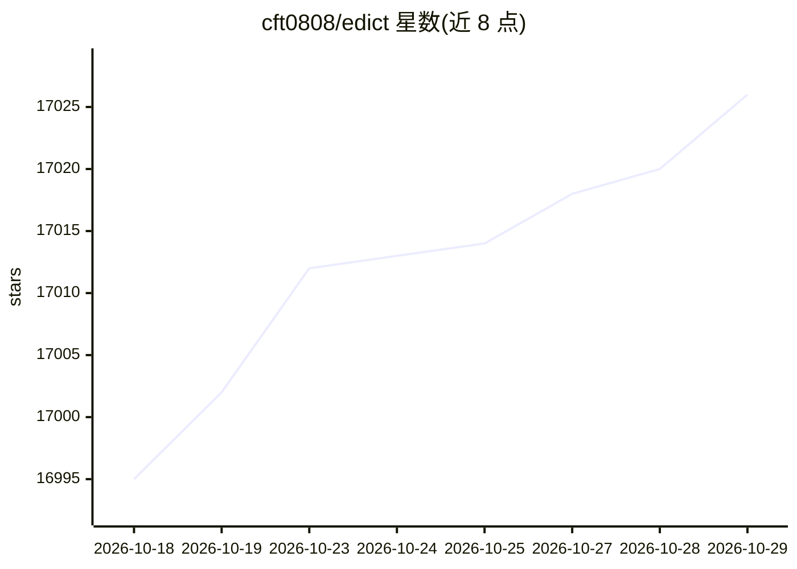

# cft0808/edict

⭐ 17,026 · Python · MIT · 推送 2026-09-28 · [GitHub](https://github.com/cft0808/edict) · [官网](https://openclaw.ai) · 个人维护 · 中文 README

**给个人/团队用的多 Agent 协作编排系统，以三省六部制分权制衡执行任务**

基于 OpenClaw 的多 Agent 编排系统，由 12 个 Agent 模拟三省六部流程：太子分拣消息、中书省规划、门下省审议封驳、尚书省派发、六部与吏部并行执行。配套 React 军机处看板，提供 Kanban 任务管理、任务叫停/取消/恢复、奏折归档、模型热切换、技能管理、Token 统计与新闻推送。依赖已安装的 OpenClaw、Python 3.10+ 与 macOS/Linux，后端基于 Python 标准库 http.server，服务间经 Redis Streams 事件总线通信，支持 Docker Demo 镜像与 systemd 部署。

## 筛选速览

| 维度 | 判定 | 备注 |
|---|---|---|
| AI 角色 | `ai-native` | 本体是模型或模型工具 |
| 许可风险 | `permissive` | MIT |
| 部署形态 | `self-host` | docker 或自建部署 |
| 模型依赖 | — | README 未给出锁定关系 |
| 硬件要求 | — | 无带数字的原话,不猜 |
| 安装摩擦 | `low` | 无编译、无系统依赖或容器化 |
| 成熟度 | — | 结构信号不足 |

## 动量与使用信号

- 维护:`active` — 距上次 push 20.3 天,年发版 0,16 位贡献者
- 涨星:近 1 天 **+5**(自 20261016 起算)
- 安装:github 包 `release-assets` 月下载无数据
- 平台:LINUX · 协议:—

## 能力要点

- 门下省专职审核，封驳不合格产出并强制返工
- Kanban 看板实时监控，支持叫停/取消/恢复与状态机校验
- Agent 权限矩阵与奏折流转审计日志
- 看板内按 Agent 热切换 LLM 与远程 Skills 导入

## 适用场景

- 通过飞书/Telegram/Signal 下达任务，让多个 Agent 分工完成并全程可视化监控
- 需要规划、审核、执行分离的任务流程管理
- 为每个 Agent 独立配置模型与技能，按看板切换

## 场景标签

`多智能体` · 领域:Agent 开发

## 证据(README 行号)

> L5:  12 个 AI Agent（11 个业务角色 + 1 个兼容角色）组成三省六部：太子分拣、中书省规划、门下省审核封驳、尚书省派发、六部+吏部并行执行。 比 CrewAI 多一层 制度性审核 ，比 AutoGen 多一个 实时看板 
> L97: ### 📋 军机处看板（10 个功能面板）
> L217: - OpenClaw 已安装

## 星数曲线

2026-10-18 16,995 → 2026-10-29 17,026（+31）

---
*卡片 v1 · prompt 1.4 · 生成 2026-10-18 · 置信度 high · 依据 README sha `d94d0115b620` · [字段定义](../../DATASET.md)*
