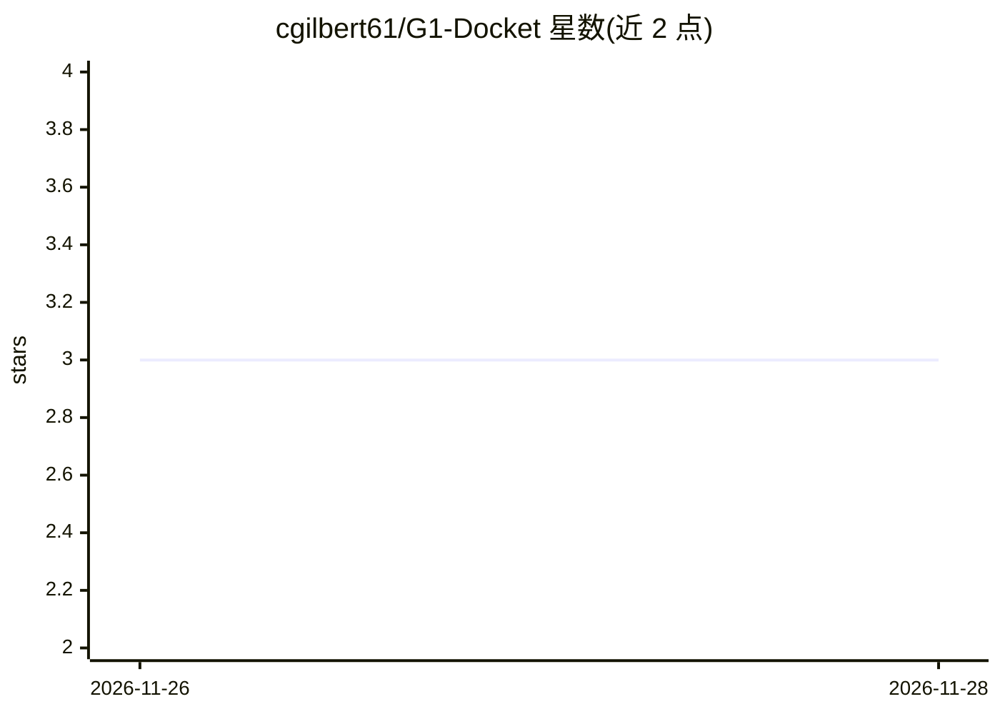

# cgilbert61/G1-Docket

⭐ 3 · Python · Apache-2.0 · 推送 2026-11-27 · [GitHub](https://github.com/cgilbert61/G1-Docket) · [官网](https://g1163rt.ai/docket) · 个人维护

**为企业和安全团队提供数据溯源证明与AI网关预校验**

数据证明框架，包含五个子系统：发现数据（通过 Apache Tika、OpenMetadata、Purview/DLP 连接器），使用 Microsoft Presidio 进行分类，并为每个对象签发 DSSE 签名的 in-toto v1 证明记录，存储在具有分级过期策略的 PostgreSQL 注册表中。发布短 TTL 签名快照，以便消费者在无需注册表调用的情况下在内存中强制执行策略。一个亚毫秒级反向代理预校验器位于支持 OpenAI、Anthropic 或 Gemini 格式（包括 SSE）的 AI 网关之前，用于转发、剥离或拒绝请求。包含 WORM 审计账本、7 目标 SIEM 转发器、双密钥 HITL 分诊、Python SDK、CLI、RAG/框架适配器以及 Helm/Kubernetes/Terraform 部署构件。

## 筛选速览

| 维度 | 判定 | 备注 |
|---|---|---|
| AI 角色 | `ai-ecosystem` | LLM/agent 周边工具 |
| 许可风险 | `permissive` | Apache-2.0 |
| 部署形态 | `self-host` | docker 或自建部署 |
| 模型依赖 | — | README 未给出锁定关系 |
| 硬件要求 | — | 无带数字的原话,不猜 |
| 安装摩擦 | `low` | 无编译、无系统依赖或容器化 |
| 成熟度 | — | 结构信号不足 |

## 能力要点

- 为每个数据对象提供 DSSE 签名的 in-toto v1 证明记录
- 零数据库调用的预校验网关，支持 OpenAI、Anthropic、Gemini 格式（含 SSE）
- 带有 Merkle 链验证的 WORM 审计账本，以及 7 目标 SIEM 转发器
- Python SDK 和针对 LangChain、LlamaIndex、CrewAI、AutoGen、LangGraph 的适配器

## 适用场景

- 在允许请求到达我的 AI 网关之前强制执行数据敏感度策略
- 为我的数据资产保留可加密验证的来源记录
- 运行一个用于网关拒绝的双密钥隔离分诊队列

## 场景标签

`网络安全` · 领域:学习与行业

## 证据(README 行号)

> L17: **Cryptographic Data Attestation Framework & Zero-DB-Call AI Gateway Prevalidator (`v1.0.2`) — G1163RT Security Lab
> L24: 4. **The Zero-DB Prevalidator Gateway (`prevalidator/`)** — A sub-millisecond reverse proxy placed in front of any 
> L26: 6. **The Developer Client SDK & Forensic Watermarking (`docket/`)** — Standalone Python client SDK (`G1-Docket-SDK`

## 星数曲线

2026-11-26 3 → 2026-11-28 3（+0）

---
*卡片 v1 · prompt 1.4 · 生成 2026-11-26 · 置信度 mid · 依据 README sha `21bb1ccfef81` · [字段定义](../../DATASET.md)*
