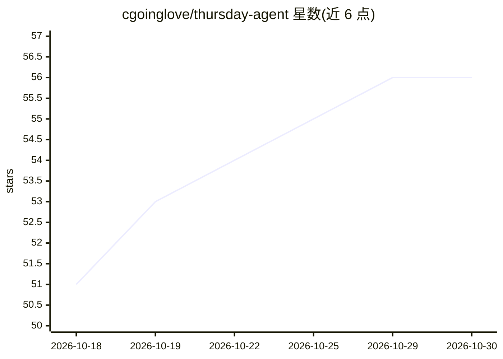

# cgoinglove/thursday-agent

⭐ 56 · TypeScript · MIT · 推送 2026-10-28 · [GitHub](https://github.com/cgoinglove/thursday-agent) · [官网](https://youtu.be/7XmsAtwQGjo) · 个人维护

**开源语音助手：你说话，一组 AI bot 操作浏览器、shell 和文件**

运行在本机的开源语音助手（GPT-Live 1 语音通话）：慢于数秒的任务交给后台 bot 团队，bot 可操作真实浏览器、shell 与本地文件，彼此交接任务并在需要决策时询问用户；结果以页面、图表、文档等文件形式保存。支持定时例程、可读写的纯文本记忆，以及 Telegram/Discord/Slack 接入。模型非本地：通话音频发送至 OpenAI，bot 可选 OpenAI、Anthropic、Google、xAI 等提供商。基于 macOS 开发，Windows 未测试。通过 npx 或源码（pnpm）运行。

## 筛选速览

| 维度 | 判定 | 备注 |
|---|---|---|
| AI 角色 | `ai-native` | 本体是模型或模型工具 |
| 许可风险 | `permissive` | MIT |
| 部署形态 | `library` | 以包/库形式分发 |
| 模型依赖 | — | README 未给出锁定关系 |
| 硬件要求 | — | 无带数字的原话,不猜 |
| 安装摩擦 | `low` | 无编译、无系统依赖或容器化 |
| 成熟度 | — | 结构信号不足 |

## 能力要点

- 语音通话中由多 bot 团队接管慢任务，任务在真实浏览器、shell 与文件上执行
- 购买流程停在 Pay 按钮留给用户确认；每笔交接保存在线程中可查看
- 结果保存为本地文件；定时例程、可读写的纯文本记忆
- 支持 Telegram/Discord/Slack/邮件写入，每 bot 可指定不同提供商模型

## 适用场景

- 用语音让 AI 团队代为网购、订票、处理表单和邮件
- 设定每日常规任务让 bot 定时执行
- 通过 Telegram/Discord/Slack 远程派发任务并查看结果

## 场景标签

`语音 Agent` `多智能体` `浏览器自动化` `AI 助手` · 领域:Agent 开发

## 证据(README 行号)

> L7: **An open-source voice assistant on GPT-Live 1, with a team of AI bots behind it.**
> L69: Thursday is an open-source voice assistant that runs on your own computer. OpenAI's GPT-Live 1 holds the call, on y

## 星数曲线

2026-10-18 51 → 2026-10-30 56（+5）

---
*卡片 v1 · prompt 1.4 · 生成 2026-10-24 · 置信度 high · 依据 README sha `16dc456ff2d6` · [字段定义](../../DATASET.md)*
