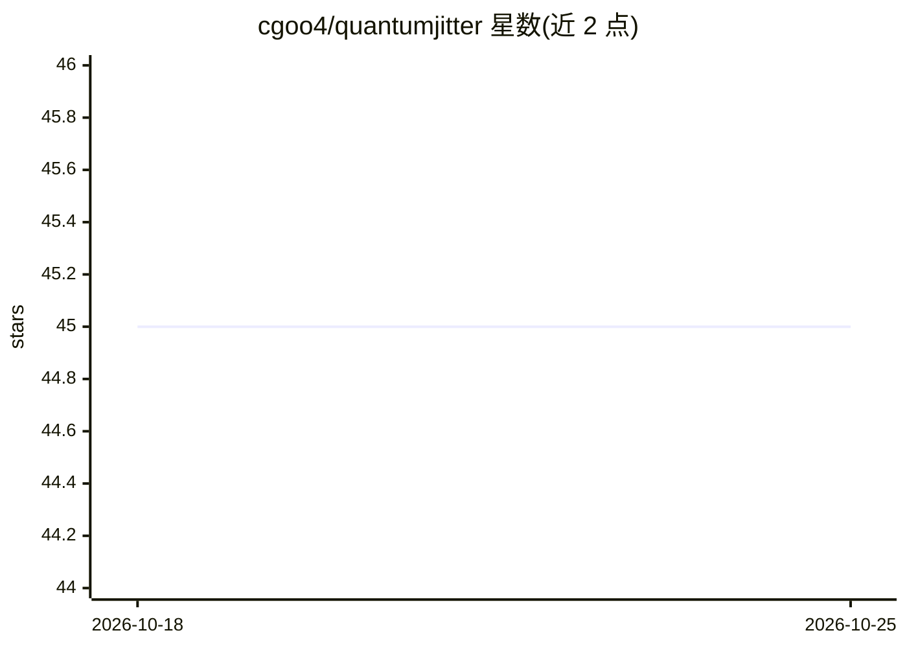

# cgoo4/quantumjitter

⭐ 45 · R · MIT · 推送 2026-10-23 · [GitHub](https://github.com/cgoo4/quantumjitter) · [官网](https://quantumjitter.com) · 个人维护

**个人数据科学与机器学习网站，基于 Quarto 发布**

个人网站 quantumjitter.com，发布使用 Quarto 构建，内容围绕数据科学与机器学习，以 tidyverse 和 tidymodels 为核心工具栈。README 仅一句话说明站点性质与发布技术，未提供安装、运行或部署细节。可见信息不足以确定具体栏目结构、更新频率或代码组织方式。

## 筛选速览

| 维度 | 判定 | 备注 |
|---|---|---|
| AI 角色 | `ai-knowledge` | 知识聚合/清单类 |
| 许可风险 | `permissive` | MIT |
| 部署形态 | `None` |  |
| 模型依赖 | — | README 未给出锁定关系 |
| 硬件要求 | — | 无带数字的原话,不猜 |
| 安装摩擦 | `low` | 无编译、无系统依赖或容器化 |
| 成熟度 | — | 结构信号不足 |

## 能力要点

- 使用 Quarto 发布的个人网站
- 内容主题为数据科学与机器学习
- 技术栈以 tidyverse 与 tidymodels 为核心

## 适用场景

- 阅读 tidyverse/tidymodels 相关的数据科学内容
- 作为 Quarto 构建个人技术站的参考实例

## 场景标签

`教程课程` · 领域:学习与行业

## 证据(README 行号)

> L3: A personal data science and machine learning website published using Quarto with the tidyverse and tidymodels at its

## 星数曲线

2026-10-18 45 → 2026-10-25 45（+0）

---
*卡片 v1 · prompt 1.4 · 生成 2026-10-25 · 置信度 low · 依据 README sha `ff185cde6276` · [字段定义](../../DATASET.md)*
