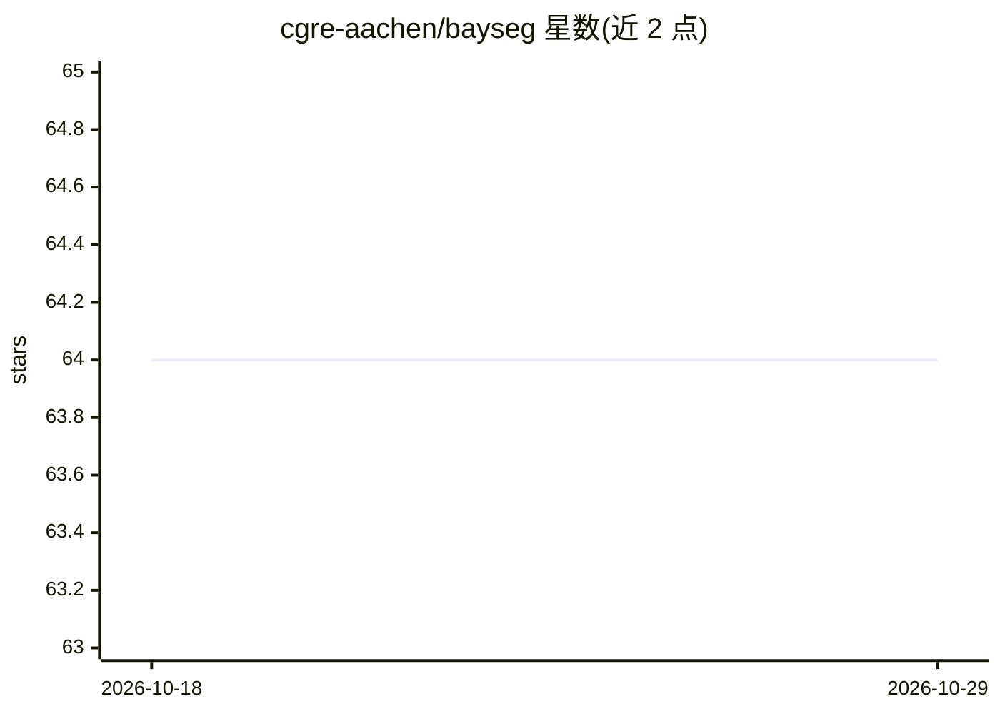

# cgre-aachen/bayseg

⭐ 64 · Jupyter Notebook · LGPL-3.0 · 推送 2026-05-27 · [GitHub](https://github.com/cgre-aachen/bayseg) · 组织维护

**地质与地球物理空间数据的无监督贝叶斯分割 Python 库**

面向地质建模与地球物理领域的 Python 库，对一至三维数据集做无监督聚类分割，算法基于 Wang 等 2017 年工作，将隐马尔可夫随机场与高斯混合模型结合在贝叶斯推断框架内。当前支持至两个物理维度，处于早期开发阶段。安装方式为克隆仓库并手动加入路径导入，计划未来提供 PyPI 安装；依赖 numpy、scikit-learn、scipy、matplotlib、tqdm。提供 1D 测井数据与 2D 地球物理/遥感数据示例，后者可通过 Binder 在浏览器中交互试用。

## 筛选速览

| 维度 | 判定 | 备注 |
|---|---|---|
| AI 角色 | `ai-native` | 本体是模型或模型工具 |
| 许可风险 | `viral` | LGPL-3.0 |
| 部署形态 | `library` | 以包/库形式分发 |
| 模型依赖 | — | README 未给出锁定关系 |
| 硬件要求 | — | 无带数字的原话,不猜 |
| 安装摩擦 | `low` | 无编译、无系统依赖或容器化 |
| 成熟度 | `idea` | |

## 能力要点

- 隐马尔可夫随机场 + 高斯混合模型的贝叶斯无监督分割
- 支持一维至三维数据的聚类分割
- 提供 1D 测井与 2D 地球物理/遥感数据示例，2D 可经 Binder 浏览器试用

## 适用场景

- 对地球物理测井数据做无监督相带分割
- 联合分割地球物理与遥感空间数据
- 地质建模中的空间模式提取

## 场景标签

 · 领域:地球物理/地质建模

## 证据(README 行号)

> L13: A Python library for unsupervised clustering of n-dimensional datasets, designed for the segmentation of one-, two-
> L14: and three-dimensional data in the field of geological modeling and geophysics. The library is based on the algorith

## 星数曲线

2026-10-18 64 → 2026-10-29 64（+0）

---
*卡片 v1 · prompt 1.4 · 生成 2026-10-24 · 置信度 mid · 依据 README sha `9d27790c8179` · [字段定义](../../DATASET.md)*
