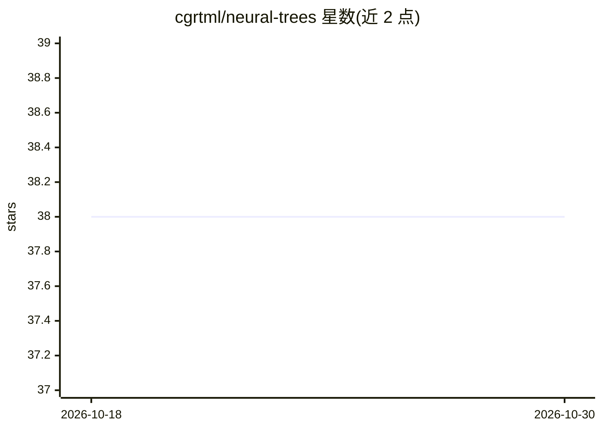

# cgrtml/neural-trees

⭐ 38 · Python · MIT · 推送 2026-10-03 · [GitHub](https://github.com/cgrtml/neural-trees) · [官网](https://pypi.org/project/neural-trees/) · 个人维护

**给开发者/科研者的软决策树与分类器比较 Python 库**

scikit-learn 兼容的机器学习库，以 PyTorch 为后端实现来自研究论文的算法：软决策树（分类/回归）、分层混合专家、多变量/全变量决策树、GAL 网络，另含 Naive Bayes 与加权 KNN。提供 explain() 逐样本解释与反事实、to_numpy()/to_onnx()/to_hard_tree() 导出、5x2cv F 检验等分类器比较检验。Torch 惰性导入，无 torch 环境下半个库（硬树、比较检验等）仍可用。附 Streamlit 交互式 playground、基准脚本与 Colab 笔记本。给需要可解释表格模型与统计比较的开发者和科研人员使用。

## 筛选速览

| 维度 | 判定 | 备注 |
|---|---|---|
| AI 角色 | `ai-native` | 本体是模型或模型工具 |
| 许可风险 | `permissive` | MIT |
| 部署形态 | `library` | 以包/库形式分发 |
| 模型依赖 | — | README 未给出锁定关系 |
| 硬件要求 | — | 无带数字的原话,不猜 |
| 安装摩擦 | `medium` | 含编译或系统依赖之一 |
| 成熟度 | — | 结构信号不足 |

## 能力要点

- sklearn 兼容 API（fit/predict/score，可用于 Pipeline）
- PyTorch 后端支持 GPU（device=auto 依次选 CUDA、Apple MPS、CPU）
- explain() 逐预测解释 + to_onnx()/to_hard_tree() 多格式导出
- 5x2cv F 检验、McNemar、配对 t 检验等分类器比较检验

## 适用场景

- 在表格数据上训练可读、可解释的软决策树或混合专家模型
- 用统计检验而非单次准确率比较多个分类器
- 复现或扩展原始论文（İrsoy、Alpaydın 等）的结果
- 在 Streamlit playground 中上传自己的 CSV/Excel 数据试验模型

## 场景标签

 · 领域:机器学习/数据科学

## 证据(README 行号)

> L3: Soft decision trees, mixture of experts, and statistical model comparison tests for Python. A scikit-learn compatibl
> L22: - Soft Decision Trees (classifier and regressor), Hierarchical Mixture of Experts, Multivariate and Omnivariate Tre
> L25: - Combined 5x2cv F test, McNemar's test, paired t-test for classifier comparison

## 星数曲线

2026-10-18 38 → 2026-10-30 38（+0）

---
*卡片 v1 · prompt 1.4 · 生成 2026-10-25 · 置信度 high · 依据 README sha `f12719ba2084` · [字段定义](../../DATASET.md)*
