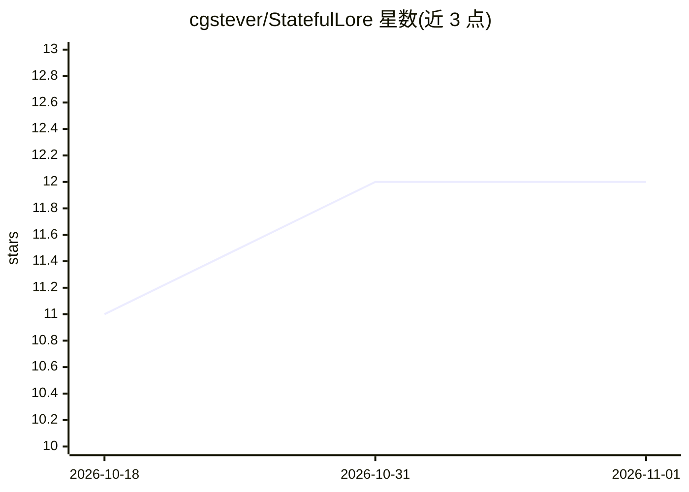

# cgstever/StatefulLore

⭐ 12 · JavaScript · MIT · 推送 2026-09-13 · [GitHub](https://github.com/cgstever/StatefulLore) · 个人维护

**SillyTavern 扩展：用有状态代码模块替换内置 lorebook**

面向 SillyTavern 角色扮演用户的浏览器扩展：用实现 processTurn()/handleResponse() 的 JavaScript lore 模块替换静态 lorebook，由扩展而非模型持有全部状态（数值、效果、物品、场景），每回合生成权威状态快照注入 prompt。状态经 IndexedDB 持久化，支持跨设备同步、从 GitHub 自动更新模块、弹出式 HUD 面板与 Scene Page 模式。要求 SillyTavern 处于 Chat Completion 模式，不支持 Text Completion。附带 D&D 5e 示例模块与 lorebook 转换指南。

## 筛选速览

| 维度 | 判定 | 备注 |
|---|---|---|
| AI 角色 | `ai-ecosystem` | LLM/agent 周边工具 |
| 许可风险 | `permissive` | MIT |
| 部署形态 | `None` |  |
| 模型依赖 | — | README 未给出锁定关系 |
| 硬件要求 | — | 无带数字的原话,不猜 |
| 安装摩擦 | `low` | 无编译、无系统依赖或容器化 |
| 成熟度 | — | 结构信号不足 |

## 能力要点

- lore 模块以代码持有全部状态，每回合注入权威快照，模型无需记忆
- 状态经 IndexedDB 持久化并支持跨设备同步
- 持久弹出 HUD 面板展示角色表/物品/任务等实时状态
- 从 GitHub raw URL 加载模块并按 version.json 自动更新

## 适用场景

- 长会话角色扮演中保持角色数值与世界状态的一致性
- 在 SillyTavern 中运行带完整规则的 D&D 5e 式游戏
- 把已有 lorebook 转换为带持久状态与机制的代码模块

## 场景标签

`聊天机器人` · 领域:对话与助手

## 证据(README 行号)

> L3: A programmable, stateful lore engine extension for SillyTavern that replaces the built-in lorebook with code-driven 
> L54: - **Programmable lore engine** — replaces ST's static lorebook with JavaScript modules that implement `processTurn(
> L130: 4. Intercepts every generation request to inject the module's context headers

## 星数曲线

2026-10-18 11 → 2026-11-01 12（+1）

---
*卡片 v1 · prompt 1.4 · 生成 2026-11-01 · 置信度 high · 依据 README sha `b8f552202872` · [字段定义](../../DATASET.md)*
