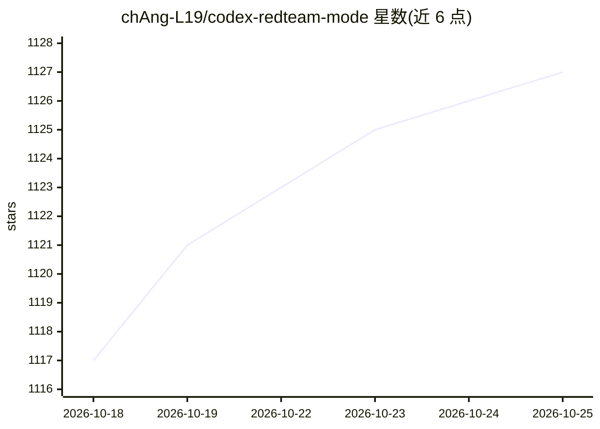

# chAng-L19/codex-redteam-mode

⭐ 1,128 · Python · MIT · 推送 2026-10-09 · [GitHub](https://github.com/chAng-L19/codex-redteam-mode) · 个人维护 · 中文 README

**给 Codex 用户的可选红队模式运行时：目标合约化并持久执行**

面向 Codex App 与 Codex CLI 的可选（opt-in）红队运行时安装器：将目标编译为带判定标准的 GoalContract，通过 stdio 或 Streamable HTTP 的 MCP 工具执行类型化 WorkflowSpec 图，用 SQLite WAL、事件、租约与幂等键支持恢复与批量并发，仅在 TerminalJudge 证明全部标准后才进入终态。默认保持 normal 模式，红队模式需显式开启；含 Hook 两层提示改写与可选本地回环 Rewrite Proxy。安装方式为 pip 装依赖后运行 scripts/install.py 部署到 Codex Home。

## 筛选速览

| 维度 | 判定 | 备注 |
|---|---|---|
| AI 角色 | `ai-ecosystem` | LLM/agent 周边工具 |
| 许可风险 | `permissive` | MIT |
| 部署形态 | `library` | 以包/库形式分发 |
| 模型依赖 | — | README 未给出锁定关系 |
| 硬件要求 | — | 无带数字的原话,不猜 |
| 安装摩擦 | `low` | 无编译、无系统依赖或容器化 |
| 成熟度 | — | 结构信号不足 |

## 能力要点

- GoalContract→WorkflowSpec→持久调度→TerminalJudge 的统一 generic-adaptive 执行路径
- 通过 stdio/Streamable HTTP MCP 发现工具，Host-only 工具按输出契约自动回传观测
- SQLite WAL/事件/租约/幂等键支持恢复、多目标批量与取消清理
- 默认 normal 模式，红队模式仅显式激活后启动；含可选 Rewrite Proxy

## 适用场景

- 在 Codex 中进行需要证据留痕与可恢复的持久红队操作
- 管理长时运行、多目标的安全任务工作流并核验完成状态
- 对 Codex 会话做模式级切换（normal/redteam-light/redteam-full）

## 场景标签

`网络安全` · 领域:学习与行业

## 证据(README 行号)

> L9: An opt-in, durable red-team runtime for Codex App and Codex CLI. It compiles each objective into a criteria-bearing 
> L70: - **Live tool collaboration**: tools are discovered through stdio or Streamable HTTP MCP; Host-only capabilities ex

## 星数曲线

2026-10-18 1,117 → 2026-10-25 1,127（+10）

---
*卡片 v1 · prompt 1.4 · 生成 2026-10-21 · 置信度 high · 依据 README sha `842db87434a2` · [字段定义](../../DATASET.md)*
