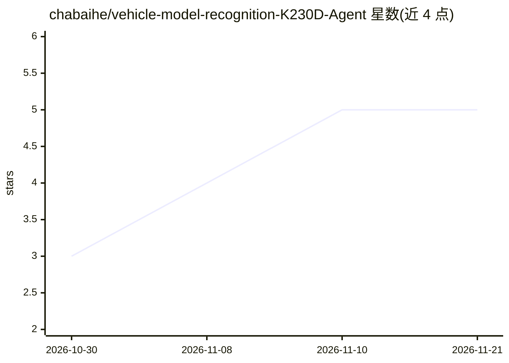

# chabaihe/vehicle-model-recognition-K230D-Agent

⭐ 5 · Python · NOASSERTION · 推送 2026-11-02 · [GitHub](https://github.com/chabaihe/vehicle-model-recognition-K230D-Agent) · 个人维护 · 中文 README

**面向开发者的 1000 类中国车辆型号识别训练与 K230D 端侧部署系统**

项目包含四个阶段：以 Stanford Cars 建立基线，改用 Car-1000 中文车型数据集训练 ResNet-50 分类模型，经 INT8 量化（97.41 MB→25.87 MB）部署到 K230D 开发板实现 28 FPS 离线识别，并搭建 ReAct 网页 Agent 对照本地小模型、云端多模态模型与联网搜索三路结果。仓库随附训练好的模型与标签表，README 主动列出视角受限、类别不均衡等局限。云端识别与搜索需自备 DeepSeek 与 Tavily 密钥，本地识别无需密钥。

## 筛选速览

| 维度 | 判定 | 备注 |
|---|---|---|
| AI 角色 | `ai-native` | 本体是模型或模型工具 |
| 许可风险 | `none` | NOASSERTION |
| 部署形态 | `desktop` | 安装包/桌面程序 |
| 模型依赖 | — | README 未给出锁定关系 |
| 硬件要求 | — | 无带数字的原话,不猜 |
| 安装摩擦 | `medium` | 含编译或系统依赖之一 |
| 成熟度 | — | 结构信号不足 |

## 能力要点

- ResNet-50 模型对 1000 类中文车型输出识别结果，随附 INT8 ONNX 与 kmodel 量化模型
- K230D 开发板完全离线运行，板端实测 28 FPS，充电宝供电
- 网页 Agent 以 ReAct 循环逐步展示本地模型、云端 LLM 与联网搜索对照过程
- 分层评估：细粒度车型 86.77%，7 个车辆大类 98.24%

## 适用场景

- 在 K230D 开发板上做离线实时车辆型号识别
- 在电脑端运行网页 Agent 对比本地小模型与云端大模型的识别差异
- 按复现指南从数据集准备到上板完整复现端侧部署流程

## 场景标签

`模型量化` `目标检测` · 领域:感知与多模态

## 证据(README 行号)

> L4: > — A 1000-class Chinese vehicle recognition system built with ResNet-50,
> L13: |Agent|Local model + cloud multimodal LLM + web search, via ReAct loop|

## 星数曲线

2026-10-30 3 → 2026-11-21 5（+2）

---
*卡片 v1 · prompt 1.4 · 生成 2026-11-21 · 置信度 high · 依据 README sha `d4f8f9d34aaa` · [字段定义](../../DATASET.md)*
