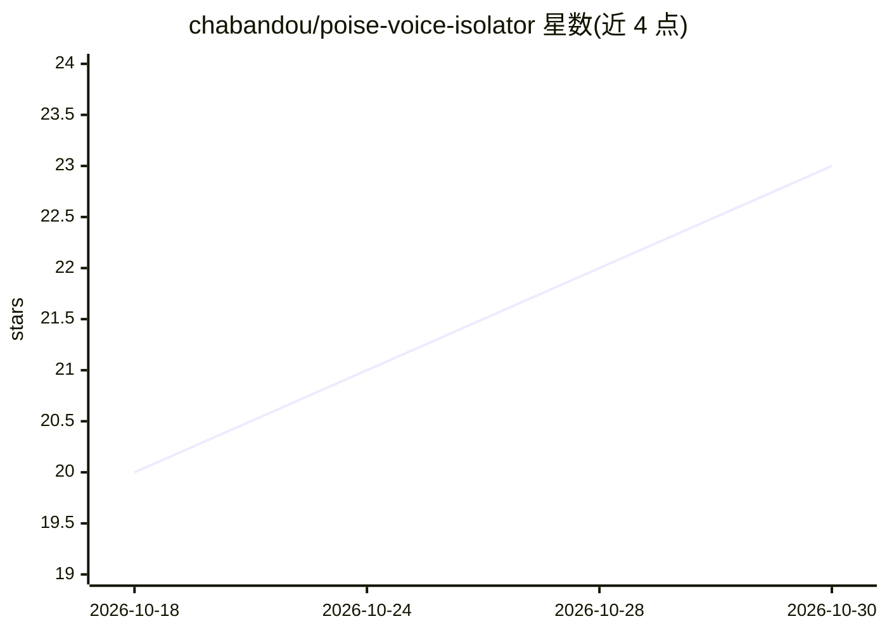

# chabandou/poise-voice-isolator

⭐ 23 · Python · MIT · 推送 2026-10-24 · [GitHub](https://github.com/chabandou/poise-voice-isolator) · [官网](https://chabandou.github.io/poise-voice-isolator/) · 个人维护

**实时分离系统音频中人声、去除音乐与噪音的本地桌面应用**

Poise 在系统音频输出与扬声器之间插入处理层：捕获系统混音（YouTube、直播、播客等），经神经网络语音模型（DeepFilterNet3/GTCRN/RNNoise，模型内置）处理后仅播放人声，全程本地运行、无云端与遥测。Linux 走 PipeWire/Pulse 虚拟 sink，Windows 依赖 VB-Cable（安装包可捆绑静默安装）。延迟固定并上报音频服务器以保持音画同步（Linux 端到端约 76 ms，Windows 约 190 ms）。提供 Windows 安装包、AUR 包与单文件二进制，另有 TUI、桌面 GUI 与 headless CLI。

## 筛选速览

| 维度 | 判定 | 备注 |
|---|---|---|
| AI 角色 | `ai-native` | 本体是模型或模型工具 |
| 许可风险 | `permissive` | MIT |
| 部署形态 | `desktop` | 安装包/桌面程序 |
| 模型依赖 | — | README 未给出锁定关系 |
| 硬件要求 | — | 无带数字的原话,不猜 |
| 安装摩擦 | `low` | 无编译、无系统依赖或容器化 |
| 成熟度 | — | 结构信号不足 |

## 能力要点

- 三个内置模型可切换：DeepFilterNet3（默认）、GTCRN（低负载）、RNNoise（稳态噪声）
- 固定延迟并上报音频服务器，端到端 Linux 约 76 ms 保持音画同步
- 静默帧跳过模型推理，笔记本 CPU 上 RTF 约 0.12×
- 全本地运行：无云端、无账号、无遥测，MIT 许可

## 适用场景

- 看在线视频/直播时去掉背景音乐只保留人声
- 在弱 CPU 设备上用 GTCRN 做低负载实时降噪
- 收听播客或流媒体时剥离配乐与噪声

## 场景标签

 · 领域:音频/语音处理

## 证据(README 行号)

> L29: Poise sits between your apps and your speakers. It takes the system mix (YouTube, streams, podcasts), runs it throu
> L31: - **Strips music, keeps speech.** DeepFilterNet3 removes instrumentals and background noise while leaving voices in

## 星数曲线

2026-10-18 20 → 2026-10-30 23（+3）

---
*卡片 v1 · prompt 1.4 · 生成 2026-10-28 · 置信度 high · 依据 README sha `0eb1d403de12` · [字段定义](../../DATASET.md)*
