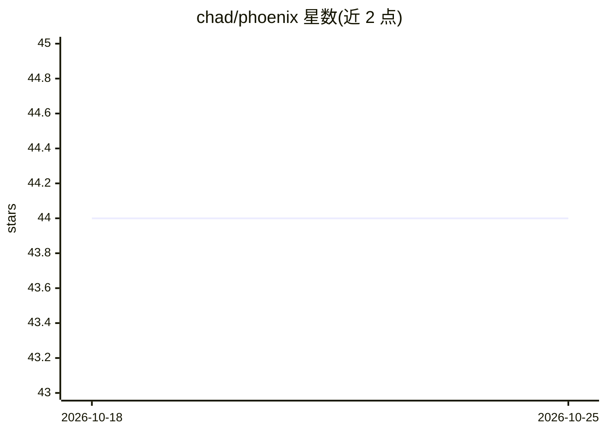

# chad/phoenix

⭐ 44 · TypeScript · 推送 2026-10-22 · [GitHub](https://github.com/chad/phoenix) · 个人维护

**把自然语言规格编译为可运行应用的再生式版本控制工具**

Phoenix 读取 markdown 编写的规格说明，经 子句→规范化需求→实现单元→生成代码 的流水线，产出含数据库、API、校验与 Web UI 的可运行应用，并记录全程溯源边（哈希链日志、phoenix why 追溯文件到规格行）。支持选择性失效：改动一行规格只重生成受影响子树；对人工改动做漂移标记（弃权/临时补丁/提升为需求）。代码生成由 LLM 驱动，可设 PHOENIX_NO_LLM 走确定性桩生成。内置 sqlite-web-api 架构目标（Hono + better-sqlite3 + Zod），可新增目标文件扩展。面向希望以规格为中心驱动开发的开发者，自述处于 Alpha 阶段。

## 筛选速览

| 维度 | 判定 | 备注 |
|---|---|---|
| AI 角色 | `ai-native` | 本体是模型或模型工具 |
| 许可风险 | `none` | — |
| 部署形态 | `library` | 以包/库形式分发 |
| 模型依赖 | — | README 未给出锁定关系 |
| 硬件要求 | — | 无带数字的原话,不猜 |
| 安装摩擦 | `low` | 无编译、无系统依赖或容器化 |
| 成熟度 | — | 结构信号不足 |

## 能力要点

- 规格→代码全程溯源（哈希链 journal、phoenix why 逐行追溯）
- 选择性失效：改一行规格仅重生成依赖子树
- 自带三臂基准（phoenix bench）：pipeline/baseline/intent 对照，Wilson 区间报告结果
- 漂移检测与标记：人工改动以弃权/临时补丁/提升为需求三种方式记录

## 适用场景

- 从行为规格直接生成带数据库与 Web UI 的 CRUD 应用
- 以规格为单一事实来源，改动规格后增量重生成代码
- 审计生成代码与需求之间的对应关系

## 场景标签

`代码生成` · 领域:编码与开发

## 证据(README 行号)

> L5: Phoenix takes a specification written in plain language, extracts structured requirements, and generates a working a
> L65: - **Code generation**: LLM generates real implementations guided by architecture-specific prompts and few-shot exam

## 星数曲线

2026-10-18 44 → 2026-10-25 44（+0）

---
*卡片 v1 · prompt 1.4 · 生成 2026-10-25 · 置信度 high · 依据 README sha `9a82673919fe` · [字段定义](../../DATASET.md)*
