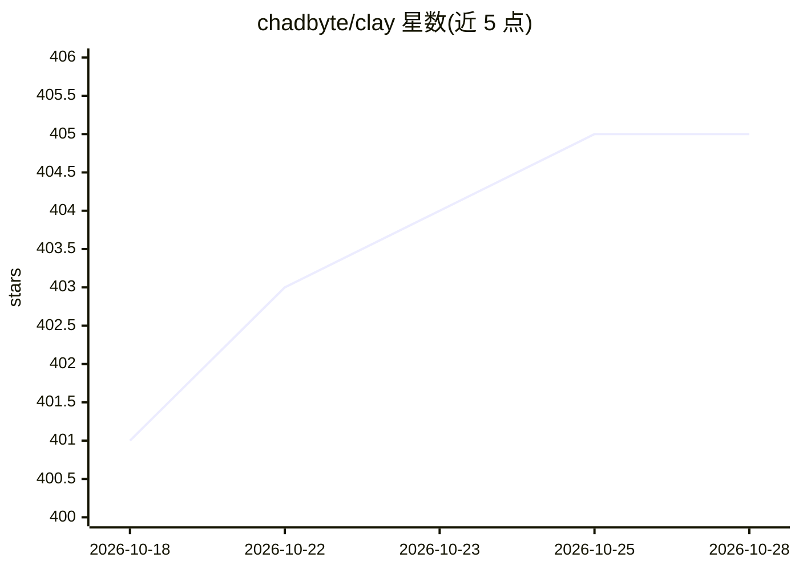

# chadbyte/clay

⭐ 405 · JavaScript · AGPL-3.0 · 推送 2026-10-23 · [GitHub](https://github.com/chadbyte/clay) · 个人维护

**自托管工作区：人与多个编码 agent 跨项目协作**

Clay Studio 是运行在本机的自托管工作区：通过浏览器统一管理并运行多个本地编码 agent CLI（Claude Code、Codex、Grok Build、Kimi Code、GitHub Copilot CLI、Qwen Code 等），支持多人进入同一会话、实时协同、交接与权限响应；提供持久化 Mates（带身份/指令/记忆的 AI 协作者）、跨提供商的 YOKE 会话接口、git worktree 并行任务、PWA 移动端与 MCP 连接。会话与知识以 JSONL/Markdown 存储在本地磁盘。需 Node.js 20+ 且至少安装一个受支持的编码 agent CLI。

## 筛选速览

| 维度 | 判定 | 备注 |
|---|---|---|
| AI 角色 | `ai-ecosystem` | LLM/agent 周边工具 |
| 许可风险 | `viral` | AGPL-3.0 |
| 部署形态 | `library` | 以包/库形式分发 |
| 模型依赖 | — | README 未给出锁定关系 |
| 硬件要求 | — | 无带数字的原话,不猜 |
| 安装摩擦 | `low` | 无编译、无系统依赖或容器化 |
| 成熟度 | — | 结构信号不足 |

## 能力要点

- 统一浏览器工作区运行 10 种编码 agent CLI
- 持久化 Mates：带身份、指令、知识与记忆的 AI 协作者
- YOLO/YOKE 跨提供商会话接口与项目指令延续
- 本地 daemon 架构，会话以 JSONL/Markdown 可移植存储

## 适用场景

- 在同一界面并行运行多个编码 agent 处理多个仓库
- 团队共享会话、实时协同与交接编码任务
- 在自有基础设施上管理 agent 会话而不依赖第三方云

## 场景标签

`编码 Agent` `多智能体` · 领域:Agent 开发

## 证据(README 行号)

> L6:  A self-hosted workspace where people and coding agents work together
> L45: **Claude Code · Codex · Grok Build · Kimi Code · GitHub Copilot CLI · Qwen Code · Junie CLI · Antigravity CLI · Ope
> L63: Browser → Clay Studio daemon → selected coding-agent runtime → model provider

## 星数曲线

2026-10-18 401 → 2026-10-28 405（+4）

---
*卡片 v1 · prompt 1.4 · 生成 2026-10-21 · 置信度 high · 依据 README sha `82008bd288c1` · [字段定义](../../DATASET.md)*
