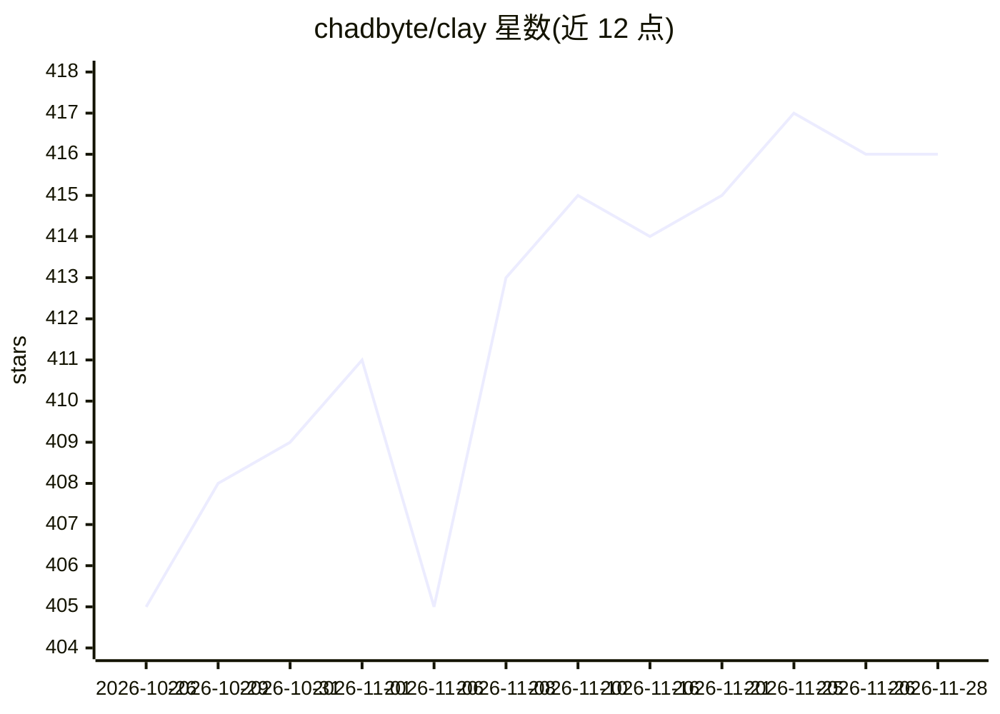

# chadbyte/clay

⭐ 416 · JavaScript · AGPL-3.0 · 推送 2026-11-27 · [GitHub](https://github.com/chadbyte/clay) · 个人维护

**自托管工作区：人与编码 Agent 跨项目协作**

Clay Studio 是一个自托管的浏览器工作区，把本地安装的多个编码 Agent CLI（Claude Code、Codex、Kimi Code 等 10 种）纳入同一团队空间。核心机制：守护进程在本机运行并经浏览器提供工作区，YOKE 层为不同 Agent 提供统一会话接口并跨厂商携带项目指令文件；支持共享项目、实时协作会话、持久化 AI 协作者（含记忆与角色）、git worktree 并行任务、移动端 PWA 与推送通知。数据以 JSONL/Markdown 存于本地磁盘，不经厂商中继。要求 Node.js 20+ 与至少一个已认证的 Agent CLI。

## 筛选速览

| 维度 | 判定 | 备注 |
|---|---|---|
| AI 角色 | `ai-ecosystem` | LLM/agent 周边工具 |
| 许可风险 | `viral` | AGPL-3.0 |
| 部署形态 | `library` | 以包/库形式分发 |
| 模型依赖 | — | README 未给出锁定关系 |
| 硬件要求 | — | 无带数字的原话,不猜 |
| 安装摩擦 | `low` | 无编译、无系统依赖或容器化 |
| 成熟度 | — | 结构信号不足 |

## 能力要点

- 一个浏览器工作区运行 10 种编码 Agent，自动检测本地已装运行时
- YOKE 提供跨厂商统一会话接口与项目指令文件携带
- 持久化 Mates：身份、指令、知识、记忆与结构化辩论角色
- 数据以 JSONL/Markdown 存于本地磁盘，流量不经云端中继

## 适用场景

- 多人围绕同一会话协作并响应 Agent 的权限请求
- 在手机上接收任务完成/失败通知并远程处理审批
- 用 git worktree 与定时任务并行管理多仓库工作

## 场景标签

`编码 Agent` · 领域:编码与开发

## 证据(README 行号)

> L14: Clay Studio turns local coding agents into a shared, persistent team. Run different agents from one browser workspa
> L41: ## Supported coding agents
> L53: - **Cross-provider continuity.** YOKE gives supported coding agents a common session interface and carries project 

## 星数曲线

2026-10-26 405 → 2026-11-28 416（+11）

---
*卡片 v1 · prompt 1.4 · 生成 2026-11-25 · 置信度 high · 依据 README sha `fe309db95172` · [字段定义](../../DATASET.md)*
