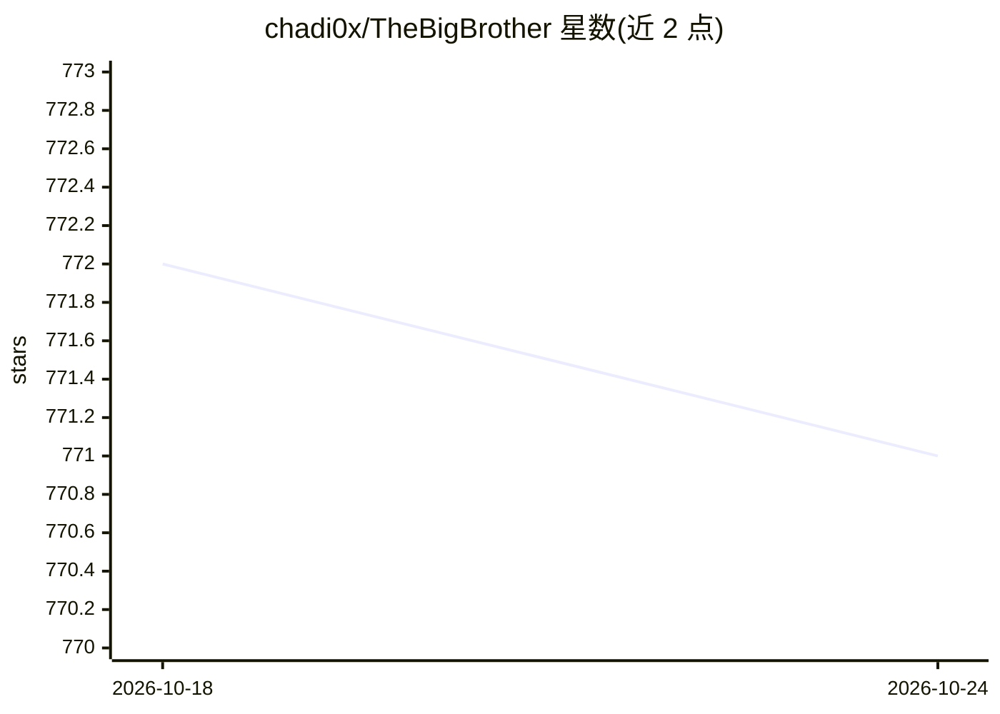

# chadi0x/TheBigBrother

⭐ 771 · Python · MIT · 推送 2026-10-13 · [GitHub](https://github.com/chadi0x/TheBigBrother) · [官网](https://thebigbrother.cloud/) · 个人维护

**面向红队与SOC的多引擎 OSINT 侦察平台（52模块/26标签）**

基于 FastAPI 异步后端与 Web 前端的 OSINT 与威胁情报平台，面向红队、SOC 分析师、地理定位专家与调查人员。提供 26 个工作区标签、每个标签双引擎共 52 个模块，覆盖用户名枚举、多链钱包追踪、信息窃取日志解析、隐写检测、语音深伪分析、LLM 注入扫描、ADS-B 飞行雷达、网络侦察等。22 个新模块为零第三方依赖的纯 Python 实现，提供 Cytoscape.js 关系图谱。通过 Docker Compose 或 Python 3.10+ 裸机部署；README 同时声明一个不开放的私有企业版与付费调查服务。

## 筛选速览

| 维度 | 判定 | 备注 |
|---|---|---|
| AI 角色 | `ai-enhanced` | 去掉 AI 部分产品仍成立 |
| 许可风险 | `permissive` | MIT |
| 部署形态 | `self-host` | docker 或自建部署 |
| 模型依赖 | — | README 未给出锁定关系 |
| 硬件要求 | — | 无带数字的原话,不猜 |
| 安装摩擦 | `low` | 无编译、无系统依赖或容器化 |
| 成熟度 | — | 结构信号不足 |

## 能力要点

- 26 标签 × 双引擎共 52 个 OSINT 模块
- 22 个新模块纯 Python 标准库实现，零第三方依赖
- Nexus Graph Canvas 从真实扫描结果实时生成关系拓扑图
- Docker Compose 一键部署，Dockerfile 多阶段构建

## 适用场景

- 对目标用户名、邮箱、手机号做多平台足迹侦察
- 追踪多链加密钱包交易与制裁名单筛查
- 分析语音/图像深伪与文档取证
- 红队与 SOC 场景下做攻击面与暴露面盘点

## 场景标签

`网络安全` · 领域:学习与行业

## 证据(README 行号)

> L38: **The Big Brother V7.0 (NEXUS)** is a state-of-the-art cyber-operations OSINT and threat intelligence platform engi
> L73: |**02**|`tab-analyst`|🤖 **AI Analyst**|♟️ **Playbook Simulator**|Cross-module synthesis, Diamond Model mapping, MIT
> L80: |**09**|`tab-voiceprint`|🎙️ **Voice Print**|⚡ **ENF Acoustic Profiler**|AI voice deepfake vocoder analysis, 50Hz (E
> L83: |**12**|`tab-shadowai`|🧠 **Shadow AI**|🔓 **Model Inversion Prober**|LLM prompt injection & jailbreak vulnerability 

## 星数曲线

2026-10-18 772 → 2026-10-24 771（-1）

---
*卡片 v1 · prompt 1.4 · 生成 2026-10-21 · 置信度 mid · 依据 README sha `de7037011309` · [字段定义](../../DATASET.md)*
