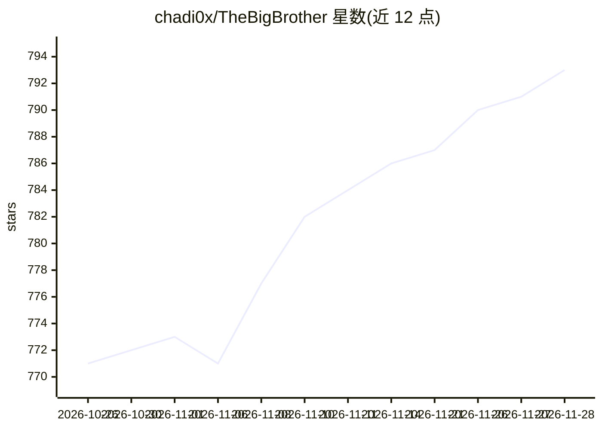

# chadi0x/TheBigBrother

⭐ 793 · Python · MIT · 推送 2026-11-14 · [GitHub](https://github.com/chadi0x/TheBigBrother) · [官网](https://thebigbrother.cloud/) · 个人维护

**面向安全调查者的 OSINT 情报平台，提供 76 个侦察引擎**

一个网络空间 OSINT 与威胁情报平台，通过三个界面组织能力：26 个标签页的双引擎战术矩阵、24 个免 API key 的 VX Arsenal 引擎，以及基于扫描载荷构建关系拓扑的 Nexus 图谱画布。引擎覆盖 DNS/证书透明度、云存储暴露、JWT/token 取证、密码泄露审计、CVE/EPSS 关联、社交平台情报、加密钱包分析与 EXIF 提取等。每个结果返回带风险评分与严重性分级的结构化信封；支持 Docker 部署，另提供免安装的在线版本。

## 筛选速览

| 维度 | 判定 | 备注 |
|---|---|---|
| AI 角色 | `ai-enhanced` | 去掉 AI 部分产品仍成立 |
| 许可风险 | `permissive` | MIT |
| 部署形态 | `self-host` | docker 或自建部署 |
| 模型依赖 | — | README 未给出锁定关系 |
| 硬件要求 | — | 无带数字的原话,不猜 |
| 安装摩擦 | `low` | 无编译、无系统依赖或容器化 |
| 成熟度 | — | 结构信号不足 |

## 能力要点

- 76 个引擎，其中 24 个 VX Arsenal 引擎无需 API key
- 统一结果信封：风险评分、严重性分级、IOC 标签与原始 JSON 检视
- Nexus Graph Canvas 从真实扫描载荷构建关系拓扑
- 提供浏览器直接访问的在线版本，无需本地安装

## 适用场景

- 红队/SOC 分析师执行攻击面评分与暴露面清点
- 调查人员做用户名枚举、数字足迹重建与地理定位
- 品牌保护团队监测 typosquat 与钓鱼链接
- 取证场景提取 EXIF 与分析加密钱包地址

## 场景标签

`网络安全` `知识图谱` · 领域:知识与检索

## 证据(README 行号)

> L41: **The Big Brother VX.1 (SOVEREIGN)** is a cyber-operations OSINT and threat-intelligence platform for Red Teams, SO
> L43: The platform now exposes **76 engines** (52 dual-engine tactical tools + 24 VX Arsenal engines) through three compl

## 星数曲线

2026-10-26 771 → 2026-11-28 793（+22）

---
*卡片 v1 · prompt 1.4 · 生成 2026-11-24 · 置信度 mid · 依据 README sha `ceec71e4be2d` · [字段定义](../../DATASET.md)*
