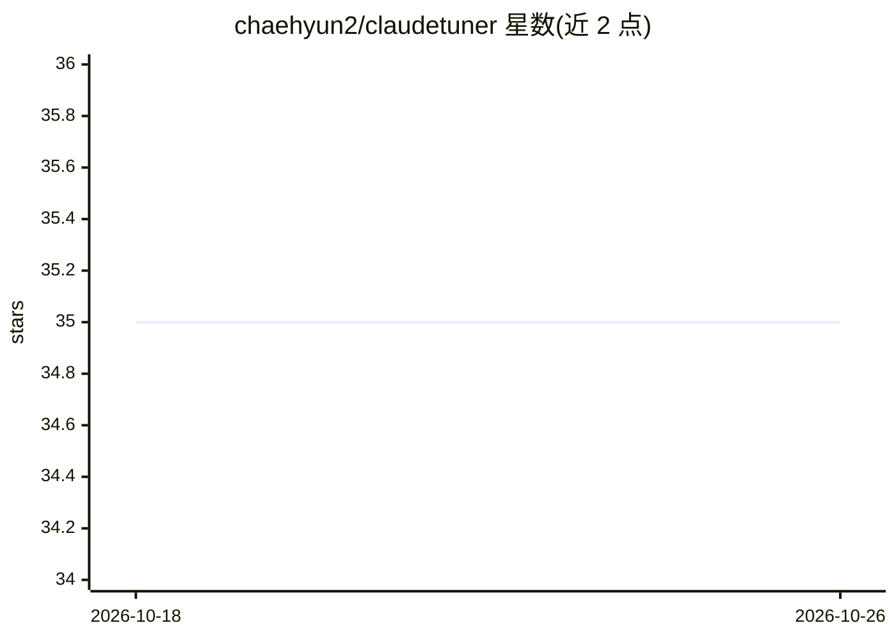

# chaehyun2/claudetuner

⭐ 35 · JavaScript · MIT · 推送 2026-10-25 · [GitHub](https://github.com/chaehyun2/claudetuner) · [官网](https://claudetuner.com) · 个人维护

**监控 Claude/ChatGPT/Gemini 用量限额的 Chrome 扩展**

Chrome 扩展加 Web 仪表盘：读取 claude.ai、ChatGPT、Gemini 账号的用量接口，实时显示 5 小时/7 天用量表、重置倒计时与超限预测；因 Claude 订阅池共享，Claude Code 与桌面端消耗也计入同一表盘。另提供套餐模拟、团队多成员仪表盘（权限控制、排行榜、CSV 导出）、24×7 活动热图，以及 beta 的 AI Cross-Check（同一问题让三家 AI 并排作答）。限制：仓库不含私有的 vendor-ai/ 模块，裸克隆无法以开发者模式加载，需从 Chrome 商店安装；支持改 config.js 指向自建服务器。

## 筛选速览

| 维度 | 判定 | 备注 |
|---|---|---|
| AI 角色 | `ai-ecosystem` | LLM/agent 周边工具 |
| 许可风险 | `permissive` | MIT |
| 部署形态 | `None` |  |
| 模型依赖 | — | README 未给出锁定关系 |
| 硬件要求 | — | 无带数字的原话,不猜 |
| 安装摩擦 | `low` | 无编译、无系统依赖或容器化 |
| 成熟度 | `idea` | |

## 能力要点

- 5h/7d 用量表、重置倒计时与 429 限流实时检测
- Claude Code 与桌面端消耗计入共享订阅池表盘
- 团队仪表盘：按成员分析、超限跟踪、访问控制、CSV/Excel 导出
- AI Cross-Check（beta）：三家 AI 并排作答，无需 API key

## 适用场景

- 多个 AI 订阅用量集中查看，避免撞限额
- 团队管理员跟踪各成员用量与超限情况
- 模拟不同套餐判断是否该升降级

## 场景标签

`LLM 可观测性` · 领域:评测与运维

## 证据(README 行号)

> L21: - **See every limit** — live 5h / 7d usage gauges with reset countdowns for Claude, ChatGPT (Codex), and Gemini, al
> L136: You ──→ Claude.ai / ChatGPT / Gemini ──→ Claude Tuner extension ──→ Claude Tuner API server
> L144: 1. **Collect** — The extension reads the same account usage endpoint claude.ai itself uses, plus ChatGPT and Gemin

## 星数曲线

2026-10-18 35 → 2026-10-26 35（+0）

---
*卡片 v1 · prompt 1.4 · 生成 2026-10-25 · 置信度 high · 依据 README sha `15d277f03dcc` · [字段定义](../../DATASET.md)*
