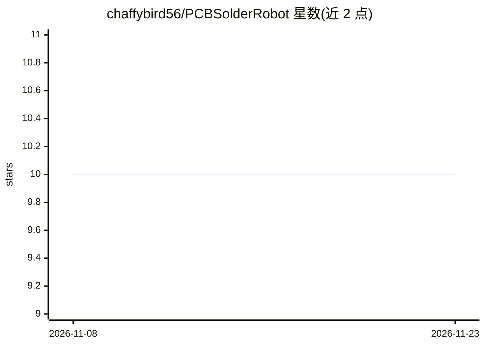

# chaffybird56/PCBSolderRobot

⭐ 10 · C · MIT · 推送 2026-06-10 · [GitHub](https://github.com/chaffybird56/PCBSolderRobot) · 组织维护

**面向 PCB 焊点质检的自主焊接机器人（本科毕设项目）**

McMaster University 团队的毕业设计项目：3 轴 CoreXY 定位平台配合送丝焊枪完成 PCB 自动焊接，Raspberry Pi 4 + HQ 摄像头在 LED 环形照明下采集焊点图像，经 HSV/Otsu 等形态学预处理后由 MobileNetV2 (α=0.75) TFLite 模型实时分类 Good/Bad/Missing 焊点；Tkinter GUI 展示视频/图像叠加结果与置信度并输出 CSV 日志。固件为 C++/PlatformIO，控制器为 Raspberry Pi Pico + TMC2209（文档中亦列 STM32H503）。无安装说明，含 70+ 页结题报告 PDF。

## 筛选速览

| 维度 | 判定 | 备注 |
|---|---|---|
| AI 角色 | `ai-enhanced` | 去掉 AI 部分产品仍成立 |
| 许可风险 | `permissive` | MIT |
| 部署形态 | `None` |  |
| 模型依赖 | — | README 未给出锁定关系 |
| 硬件要求 | — | 无带数字的原话,不猜 |
| 安装摩擦 | `low` | 无编译、无系统依赖或容器化 |
| 成熟度 | — | 结构信号不足 |

## 能力要点

- MobileNetV2 (TFLite) 实时三分类焊点质检（Good/Bad/Missing）
- CoreXY 皮带传动 3 轴定位 + 送丝焊枪的完整机械/电子/固件设计
- Tkinter GUI 支持相机/图像/视频输入并输出 CSV 日志
- LabelImg 标注 + 数据增强（约 7 倍扩充）的训练流程

## 适用场景

- PCB 手工/小批量焊接后的焊点质量自动检测
- 学习视觉引导机器人的机械、电子与固件集成设计
- 复用其图像预处理与轻量分类流水线做工业质检实验

## 场景标签

`目标检测` · 领域:感知与多模态

## 证据(README 行号)

> L10:  A CNC precision 3-axis automated PCB soldering system with vision processing and AI solder recognition for in-app 
> L27: This project implements an **autonomous PCB soldering robot**that combines precision CNC motion control, computer v
> L51: The system integrates **six major subsystems**: mechanical positioning (CoreXY motion + Z-axis), custom electronics

## 星数曲线

2026-11-08 10 → 2026-11-23 10（+0）

---
*卡片 v1 · prompt 1.4 · 生成 2026-11-19 · 置信度 high · 依据 README sha `2c556e0be4b5` · [字段定义](../../DATASET.md)*
