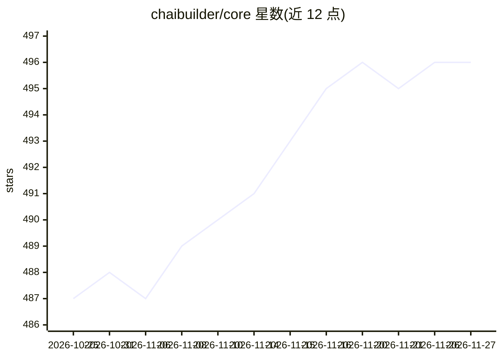

# chaibuilder/core

⭐ 496 · TypeScript · BSD-3-Clause · 推送 2026-11-26 · [GitHub](https://github.com/chaibuilder/core) · [官网](https://chaibuilder.com) · 组织维护

**给 Next.js 开发者的开源可视化建站工具，含 AI 辅助编辑**

面向 Next.js ≥15.3 / React 19 / Tailwind 4 的可视化页面构建器，以 npm 包或 git subtree 方式集成到既有项目。提供拖拽块编辑器、自定义 React 块注册（带类型化 props schema）、请求级服务端配置、RSC 渲染与草稿预览、数据绑定管道及 UI 扩展机制。AI 功能基于 Vercel AI SDK，通过可插拔 provider 插件接入各模型服务，默认走 Vercel AI Gateway；数据库支持 LibSQL、D1、better-sqlite3 适配器，schema 由宿主应用自行管理迁移。

## 筛选速览

| 维度 | 判定 | 备注 |
|---|---|---|
| AI 角色 | `ai-enhanced` | 去掉 AI 部分产品仍成立 |
| 许可风险 | `permissive` | BSD-3-Clause |
| 部署形态 | `library` | 以包/库形式分发 |
| 模型依赖 | local-ok | 支持本地模型 |
| 硬件要求 | — | 无带数字的原话,不猜 |
| 安装摩擦 | `low` | 无编译、无系统依赖或容器化 |
| 成熟度 | — | 结构信号不足 |

## 能力要点

- 块级拖拽可视化编辑器，支持注册自定义 React 块
- AI 功能基于 Vercel AI SDK，provider 以插件形式可插拔
- 支持 LibSQL / Cloudflare D1 / better-sqlite3 数据库适配器
- 提供数据绑定管道与条件可见性布尔管道机制

## 适用场景

- 在 Next.js 项目中嵌入可视化页面编辑能力
- 让非技术团队通过拖拽编辑营销页面
- 通过 OpenAI 兼容端点或 Ollama 为编辑器接入 AI 辅助

## 场景标签

 · 领域:网站构建/低代码工具

## 证据(README 行号)

> L3: **AI-enabled visual website builder for Next.js.**
> L21: |Visual editor|Drag-and-drop canvas with Tailwind styling, media, SEO, and AI assist|
> L223: ChaiBuilder's AI features run on the Vercel AI SDK. Model ids use the

## 星数曲线

2026-10-25 487 → 2026-11-27 496（+9）

---
*卡片 v1 · prompt 1.4 · 生成 2026-11-25 · 置信度 high · 依据 README sha `d04288bc815c` · [字段定义](../../DATASET.md)*
