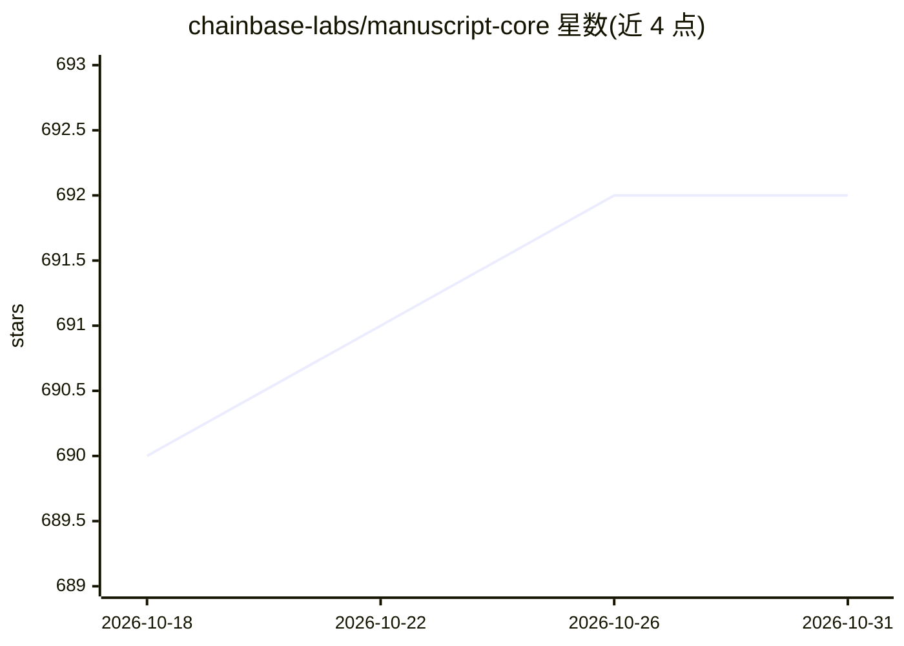

# chainbase-labs/manuscript-core

⭐ 692 · Rust · Apache-2.0 · 推送 2026-08-09 · [GitHub](https://github.com/chainbase-labs/manuscript-core) · [官网](https://chainbase.com) · 组织维护

**面向 Chainbase 网络的区块链数据流处理框架，支持链上/链下数据入仓查询**

Chainbase 团队维护的区块链数据流处理框架：用户以 manuscript.yaml 描述数据源、转换逻辑与数据流向，框架在本地 Docker Compose 容器集群中启动 Flink 流处理集群，消费链上数据并写入 MySQL、PostgreSQL、BigQuery 等目标存储，之后通过 GraphQL 端点查询。提供 GUI 客户端与 CLI 两种安装方式（curl 安装脚本），本地测试后可规划部署至 Chainbase 分布式网络。v1.5.0 新增 Solana 链上解析器。README 未描述具体 AI/模型功能。

## 筛选速览

| 维度 | 判定 | 备注 |
|---|---|---|
| AI 角色 | `ai-enhanced` | 去掉 AI 部分产品仍成立 |
| 许可风险 | `permissive` | Apache-2.0 |
| 部署形态 | `self-host` | docker 或自建部署 |
| 模型依赖 | — | README 未给出锁定关系 |
| 硬件要求 | — | 无带数字的原话,不猜 |
| 安装摩擦 | `low` | 无编译、无系统依赖或容器化 |
| 成熟度 | — | 结构信号不足 |

## 能力要点

- manuscript.yaml 描述数据源、transform 与 sink 的工作流
- 本地 Docker Compose 启动 Flink 集群做流处理，GraphQL 端点查询结果
- 支持写入 MySQL/PostgreSQL/BigQuery/S3/IPFS 等多种目标服务
- 提供 GUI 客户端与 CLI 两种使用方式

## 适用场景

- 把链上数据流式同步到本地或云端数据库做分析
- 多链与链下数据聚合后通过 GraphQL 查询
- 构建自定义区块链数据管道并部署到 Chainbase 网络

## 场景标签

 · 领域:区块链数据基础设施

## 证据(README 行号)

> L22: Chainbase is a global blockchain data network with an extensive dataset and cluster worldwide. If we compare Chainb
> L27: Manuscript is not just a language specification; it’s a protocol, framework, and toolkit designed to simplify and u
> L142: - Start a default stream processing framework, such as a Flink cluster.

## 星数曲线

2026-10-18 690 → 2026-10-31 692（+2）

---
*卡片 v1 · prompt 1.4 · 生成 2026-10-21 · 置信度 low · 依据 README sha `badcd7911f72` · [字段定义](../../DATASET.md)*
