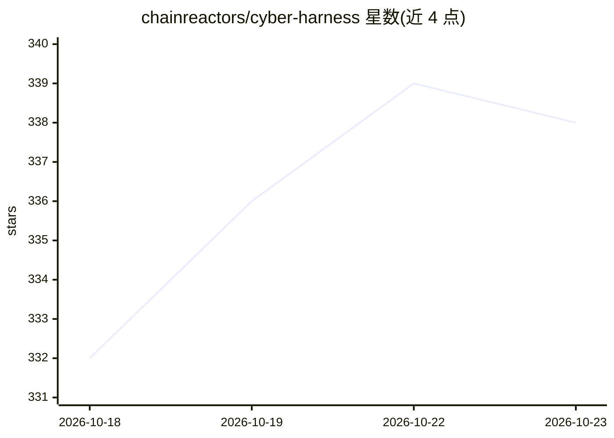

# chainreactors/cyber-harness

⭐ 338 · Go · AGPL-3.0 · 推送 2026-10-18 · [GitHub](https://github.com/chainreactors/cyber-harness) · 组织维护 · 中文 README

**网络安全工作流通用 Agent 框架：可嵌入、全扩展化的攻防工具集**

用 Go 编写的通用 Agent 框架，面向渗透测试、红队、代码审计等网络安全工作流。模型推理、工具执行、知识、观测与协作均通过同一扩展生命周期组装，任务与已安装扩展决定可用工具与流程。提供四个入口：aiscan（Agent 任务与扫描器，完整版含浏览器自动化与爬虫）、cyber-audit（模型主导的源码/二进制审计）、cyber-web（会话与工件 Web Hub）及最小化本地 agent。可下载二进制运行，也可从源码构建，并支持嵌入自定义 Go 应用。LLM 通过 OpenAI/Anthropic 兼容协议接入。仅限授权目标使用。

## 筛选速览

| 维度 | 判定 | 备注 |
|---|---|---|
| AI 角色 | `ai-ecosystem` | LLM/agent 周边工具 |
| 许可风险 | `viral` | AGPL-3.0 |
| 部署形态 | `desktop` | 安装包/桌面程序 |
| 模型依赖 | — | README 未给出锁定关系 |
| 硬件要求 | — | 无带数字的原话,不猜 |
| 安装摩擦 | `low` | 无编译、无系统依赖或容器化 |
| 成熟度 | — | 结构信号不足 |

## 能力要点

- 四个入口：aiscan/aiscan-full、cyber-audit、cyber-web、最小 agent
- 一切皆扩展：模型、工具、知识、观测、协作共用扩展生命周期
- 配置文件接入 OpenAI/Anthropic 兼容 LLM 服务（示例为 DeepSeek）
- 可编译单二进制并嵌入自定义 Go 应用

## 适用场景

- 在授权目标上执行 Agent 驱动的扫描与侦察任务
- 让模型主导源码或二进制审计并生成证据与报告
- 通过 Web Hub 管理会话、事件与扫描/审计节点

## 场景标签

`Agent 框架` `网络安全` · 领域:Agent 开发

## 证据(README 行号)

> L13: cyber-harness is a general-purpose agent harness for cyber workflows. Model reasoning, tool execution, knowledge, o
> L21: |`cyber-web` (from source)|A profile-neutral Web Hub for sessions, events and artifacts from scan, audit or custom 
> L76: |Build a Go application or embed a session|Developer guide|

## 星数曲线

2026-10-18 332 → 2026-10-23 338（+6）

---
*卡片 v1 · prompt 1.4 · 生成 2026-10-21 · 置信度 high · 依据 README sha `b093a8a61205` · [字段定义](../../DATASET.md)*
