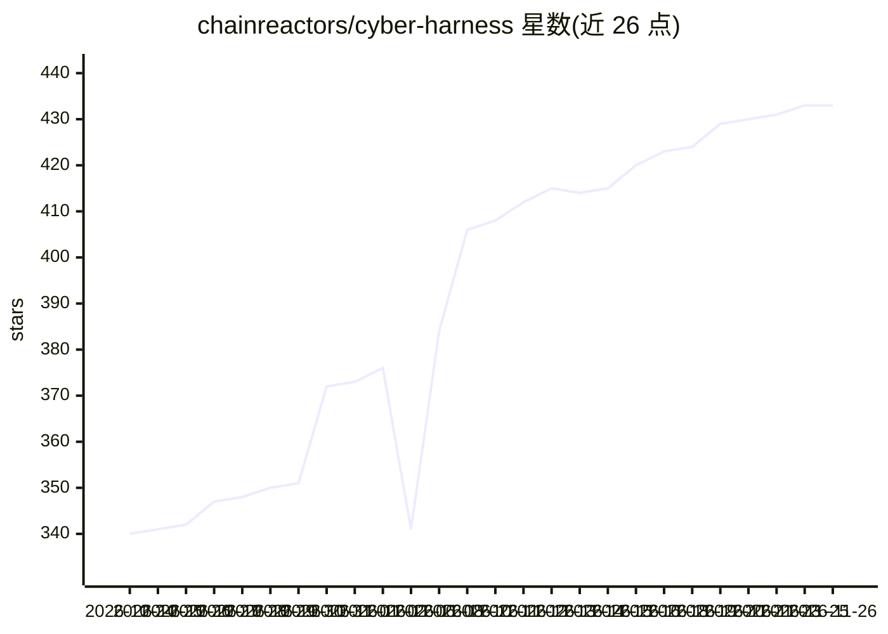

# chainreactors/cyber-harness

⭐ 433 · Go · AGPL-3.0 · 推送 2026-11-25 · [GitHub](https://github.com/chainreactors/cyber-harness) · 组织维护 · 中文 README

**面向网络安全工作流的通用 agent harness，覆盖渗透/审计**

以 Go 编写的通用 agent harness，将模型推理、工具执行、知识、观测与协作统一通过扩展生命周期组装；提供 cyber-scan（扫描/代理/浏览器自动化）、cyber-audit（源码与二进制审计）、cyber-harness（Web Hub 管理会话与产物）及最小本地 agent 四个入口。通过 cyber.yaml 配置 LLM provider 与端点，节点可经 --server-url 连接 Hub。发布预编译二进制，也可用 Go/Make 从源码构建；文档以中文为主维护。

## 筛选速览

| 维度 | 判定 | 备注 |
|---|---|---|
| AI 角色 | `ai-ecosystem` | LLM/agent 周边工具 |
| 许可风险 | `viral` | AGPL-3.0 |
| 部署形态 | `desktop` | 安装包/桌面程序 |
| 模型依赖 | — | README 未给出锁定关系 |
| 硬件要求 | — | 无带数字的原话,不猜 |
| 安装摩擦 | `low` | 无编译、无系统依赖或容器化 |
| 成熟度 | — | 结构信号不足 |

## 能力要点

- 四个入口：cyber-scan、cyber-audit、cyber-harness Web Hub 与最小本地 agent
- 模型、工具、知识与协作统一经扩展生命周期组装，可嵌入自研 Go 应用
- 支持 openai/anthropic 两种 provider 协议配置（cyber.yaml）
- GitHub Releases 提供多平台预编译二进制

## 适用场景

- 在授权目标上运行 agent 驱动的扫描与被动侦察
- 对源码或二进制做模型主导的审计并收集证据生成报告
- 用 Web Hub 集中管理多个扫描/审计执行节点

## 场景标签

`网络安全` · 领域:学习与行业

## 证据(README 行号)

> L13: cyber-harness is a general-purpose agent harness for cyber workflows. Model reasoning, tool execution, knowledge, o
> L54: Run `cyber-harness init` or `cyber-scan init` to configure your model in `~/.cyber/cyber.yaml`. For project overrid

## 星数曲线

2026-10-24 340 → 2026-11-26 433（+93）

---
*卡片 v1 · prompt 1.4 · 生成 2026-11-25 · 置信度 high · 依据 README sha `1de6d640c35c` · [字段定义](../../DATASET.md)*
