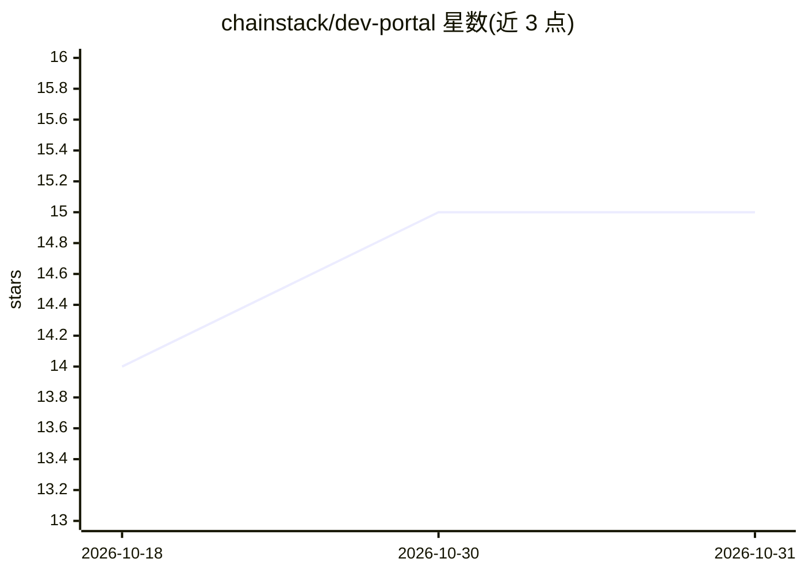

# chainstack/dev-portal

⭐ 15 · MDX · 推送 2026-10-30 · [GitHub](https://github.com/chainstack/dev-portal) · [官网](https://docs.chainstack.com) · 组织维护

**Chainstack 区块链开发者文档门户，含托管 MCP 服务**

Chainstack 公司的官方开发者文档仓库，基于 Mintlify 构建，覆盖 Cloud（托管区块链基础设施）与 Self-Hosted 两个产品线，含交互式 RPC 节点 API 参考。面向 AI/LLM 使用场景提供多种访问方式：公开仓库可直接摄取、自动生成 llms-full.txt 与 skill.md、任意页面可加 .md 后缀获取 markdown、以及部署在 docs.chainstack.com/mcp 的 streamable HTTP 托管 MCP 服务器，支持 Claude Code、Cursor、VS Code、Windsurf 接入。该 MCP 为文档服务，区别于在建的 RPC 节点 MCP。

## 筛选速览

| 维度 | 判定 | 备注 |
|---|---|---|
| AI 角色 | `ai-knowledge` | 知识聚合/清单类 |
| 许可风险 | `none` | — |
| 部署形态 | `library` | 以包/库形式分发 |
| 模型依赖 | — | README 未给出锁定关系 |
| 硬件要求 | — | 无带数字的原话,不猜 |
| 安装摩擦 | `low` | 无编译、无系统依赖或容器化 |
| 成熟度 | — | 结构信号不足 |

## 能力要点

- 托管 MCP 服务器（streamable HTTP），供 AI 模型搜索和浏览全部 Chainstack 文档
- llms-full.txt 与 skill.md 每次变更自动生成发布
- 任意文档页可加 .md 后缀获取 markdown 版本
- node-options-master-list.json 维护全部节点选项，可交给 LLM 生成自定义表格

## 适用场景

- 查阅 Chainstack 区块链节点服务的使用文档与 API 参考
- 让 Claude Code/Cursor 等 AI 工具通过 MCP 直接检索 Chainstack 文档
- 用 LLM 从节点选项主列表生成自定义对比表格

## 场景标签

`教程课程` · 领域:学习与行业

## 证据(README 行号)

> L23: The Chainstack Developer Portal provides a hosted MCP (Model Context Protocol) server at `https://docs.chainstack.c
> L25: This is a **streamable HTTP** MCP server (not SSE). It provides AI models with access to search and navigate throug
> L14: * llms-full.txt is automatically generated and published on every change.

## 星数曲线

2026-10-18 14 → 2026-10-31 15（+1）

---
*卡片 v1 · prompt 1.4 · 生成 2026-10-30 · 置信度 mid · 依据 README sha `153bd1cafa72` · [字段定义](../../DATASET.md)*
