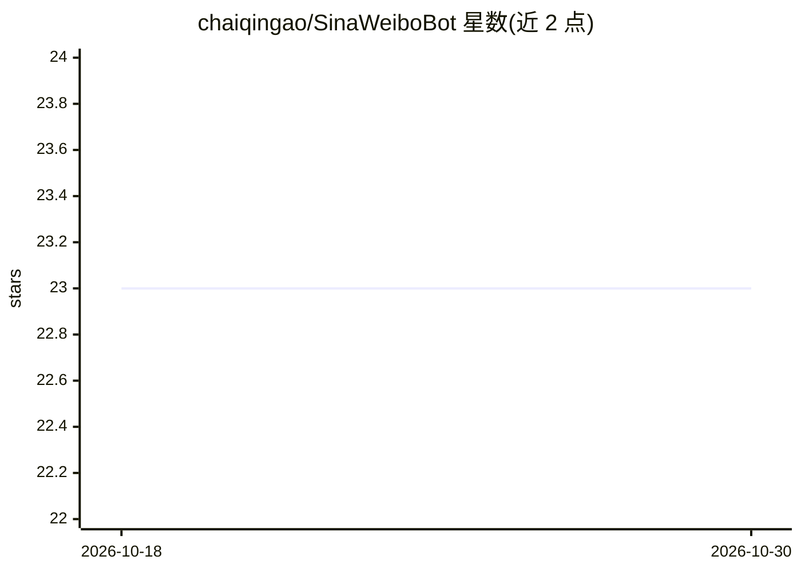

# chaiqingao/SinaWeiboBot

⭐ — · [GitHub]() · 个人维护 · 中文 README

**新浪微博机器人：LLM 自动回复与定时发博任务**

用 Python 编写的新浪微博机器人，通过微博开放平台 API 与 Access Token 认证，基于 APScheduler 调度定时任务。功能包括基于 LLM 的自动回复、剧集更新提醒（追更）、每日诗词、每日一句英语。任务通过在 main.py 中编写代码配置，如按剧集 id 跟踪更新并以分钟级间隔检查、每日固定时间发送诗词或英语内容。以 git clone 源码方式安装，需自备微博开放平台应用与 Access Token；README 显示有部署在树莓派上的 demo 账号。

## 筛选速览

| 维度 | 判定 | 备注 |
|---|---|---|
| AI 角色 | `ai-native` | 本体是模型或模型工具 |
| 许可风险 | `permissive` | — |
| 部署形态 | `library` | 以包/库形式分发 |
| 模型依赖 | — | README 未给出锁定关系 |
| 硬件要求 | — | 无带数字的原话,不猜 |
| 安装摩擦 | `low` | 无编译、无系统依赖或容器化 |
| 成熟度 | — | 结构信号不足 |

## 能力要点

- 基于 LLM 的微博自动回复
- 剧集更新提醒（追更）任务，可配置检查间隔
- 每日诗词、每日一句英语定时发送
- APScheduler 驱动的可编程定时任务

## 适用场景

- 运营一个自动回复评论的微博账号
- 追更剧集并在更新时提醒指定用户
- 每日定时发布诗词或英语学习内容

## 场景标签

`工作流自动化` · 领域:效率与自动化

## 证据(README 行号)

> L1: # SinaWeiboBot
> L4: demo: @追更bot（部署在一块树莓派上）

## 星数曲线

2026-10-18 23 → 2026-10-30 23（+0）

---
*卡片 v1 · prompt 1.4 · 生成 2026-10-27 · 置信度 low · 依据 README sha `f011906b3ecc` · [字段定义](../../DATASET.md)*
