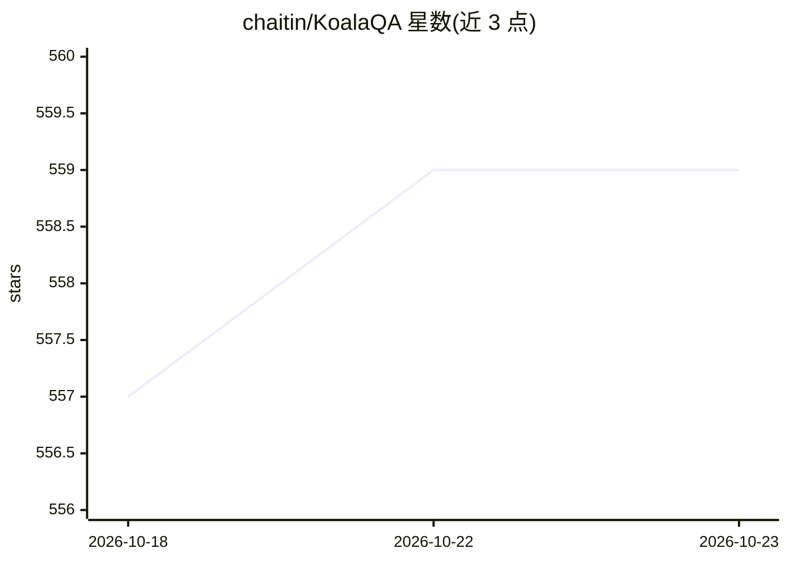

# chaitin/KoalaQA

⭐ 559 · TypeScript · 推送 2026-07-15 · [GitHub](https://github.com/chaitin/KoalaQA) · [官网](https://koalaqa.docs.baizhi.cloud) · 组织维护 · 中文 README

**AI 大模型驱动的开源售后服务社区与智能客服产品**

面向企业内外部问答平台、开发者社区与用户服务社区的开源产品，技术栈为 Go/React/TS/Docker。提供 AI 智能客服实时应答（自动处理约 90% 常见问题，复杂问题转人工）、AI 知识库（自动生成问答对、洞察知识缺口）、AI 搜索与 AI 运营能力，目标是降低人工运营成本、实现 ZCR（零人工介入解决）。安装需 Linux + Docker 20.x，通过脚本一键部署；首次使用需接入 AI 大模型（推荐百智云模型广场），AI 回答基于知识库检索结果归纳。支持多板块权限管理、企业微信/微信扫码/OIDC 认证，Web 与移动端均可访问。许可证为 AGPL-3.0。

## 筛选速览

| 维度 | 判定 | 备注 |
|---|---|---|
| AI 角色 | `ai-native` | 本体是模型或模型工具 |
| 许可风险 | `none` | — |
| 部署形态 | `None` |  |
| 模型依赖 | — | README 未给出锁定关系 |
| 硬件要求 | — | 无带数字的原话,不猜 |
| 安装摩擦 | `low` | 无编译、无系统依赖或容器化 |
| 成熟度 | — | 结构信号不足 |

## 能力要点

- AI 客服自动处理约 90% 常见问题，复杂问题转人工
- AI 知识库自动生成问答对并洞察知识缺口
- RAG 式回答：大模型基于知识库检索结果归纳总结
- 支持企业微信扫码、微信扫码、OIDC 认证与多板块权限管理

## 适用场景

- 搭建企业售后服务与客服问答平台
- 建设开发者社区或用户服务社区
- 通过 AI 客服降低人工客服成本，推进零人工介入解决

## 场景标签

`聊天机器人` `知识库管理` · 领域:对话与助手

## 证据(README 行号)

> L12: **KoalaQA** 是一款 AI 大模型驱动的开源智能售后服务产品，提供 **AI 客服、AI 洞察、AI 搜索、AI 运营**等能力，帮助你快速搭建**企业内外部问答平台、开发者社区、用户服务社区**，帮助团队显著降低人工运
> L22: - **AI 智能客服全天侯实时应答**：理解客户意图、自然回答问题，自动处理约 90% 的常见问题，复杂问题智能转接人工客服，为客户提供更高效自然的服务体验。

## 星数曲线

2026-10-18 557 → 2026-10-23 559（+2）

---
*卡片 v1 · prompt 1.4 · 生成 2026-10-21 · 置信度 high · 依据 README sha `53f3b191eda0` · [字段定义](../../DATASET.md)*
