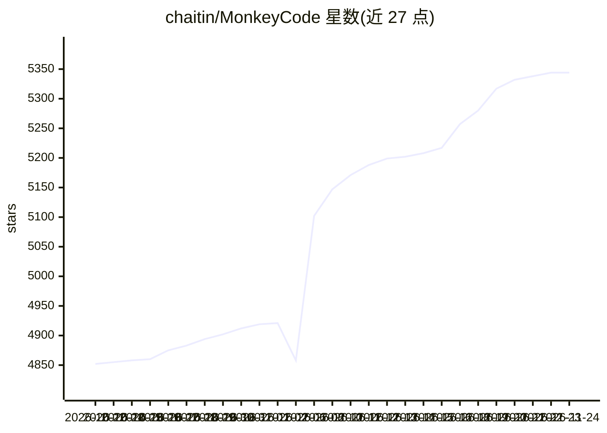

# chaitin/MonkeyCode

⭐ 5,344 · TypeScript · AGPL-3.0 · 推送 2026-11-20 · [GitHub](https://github.com/chaitin/MonkeyCode) · [官网](https://work.baizhi.cloud/) · 组织维护 · 中文 README

**面向团队的企业级开源 AI 办公工作台**

百智办公（MonkeyCode/MonkeyAI）是一个团队 AI 办公平台：成员用自然语言提出需求，由 AI 执行办公（PPT/文档/表格）、编程与设计任务并交付成果。平台提供企业管理面板，统一管理团队共享的大模型、知识库、技能、专家与 MCP 连接器，含权限控制、使用审计与计费统计。支持脚本一键私有化部署（标注最低 1 核 CPU + 1 GB 内存），客户端覆盖 Web、Windows、macOS、Linux；提供免费版（最多 10 席位）与付费版，AGPL-3.0 开源。

## 筛选速览

| 维度 | 判定 | 备注 |
|---|---|---|
| AI 角色 | `ai-native` | 本体是模型或模型工具 |
| 许可风险 | `viral` | AGPL-3.0 |
| 部署形态 | `self-host` | docker 或自建部署 |
| 模型依赖 | — | README 未给出锁定关系 |
| 硬件要求 | — | 无带数字的原话,不猜 |
| 安装摩擦 | `low` | 无编译、无系统依赖或容器化 |
| 成熟度 | — | 结构信号不足 |

## 能力要点

- 覆盖办公、编程、设计三类任务的 AI 工作台
- 企业管理面板：资源共享、权限控制、使用审计与计费
- 一条命令脚本私有化部署，数据保存在自有服务器
- 支持接入自选模型服务与 MCP 连接器

## 适用场景

- 团队私有化部署统一的 AI 办公入口
- 给不会编程的成员用自然语言生成 PPT、文档与分析
- 按权限与审计要求管理团队 AI 资源使用

## 场景标签

`AI 助手` `代码生成` `AI 写作` · 领域:编码与开发

## 证据(README 行号)

> L7: 百智办公是一款面向团队的开源 AI 办公工作台。用自然语言提出需求，让 AI 完成办公、编程与设计任务，直接交付工作成果。支持团队资源共享、统一管控与私有化部署。
> L47: |团队资源共享|在团队内共享大模型、知识库、技能、专家、MCP 连接器和规则，让成员复用已有资源。|

## 星数曲线

2026-10-22 4,852 → 2026-11-24 5,344（+492）

---
*卡片 v1 · prompt 1.4 · 生成 2026-11-22 · 置信度 high · 依据 README sha `5240120ef114` · [字段定义](../../DATASET.md)*
