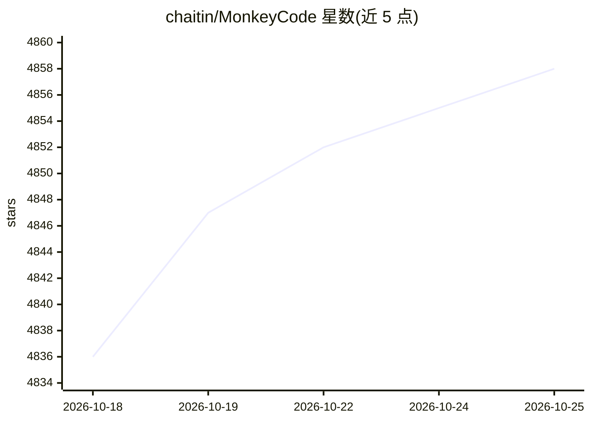

# chaitin/MonkeyCode

⭐ 4,858 · TypeScript · AGPL-3.0 · 推送 2026-10-23 · [GitHub](https://github.com/chaitin/MonkeyCode) · [官网](https://work.baizhi.cloud/) · 组织维护 · 中文 README

**面向企业研发团队的开源 AI 编码开发平台**

开源的企业级 AI 开发平台，包含开发环境管理、AI 模型管理、AI 任务管理与项目需求管理四个模块。任务在云端服务端环境中运行，完成构建、测试与预览；集成 GLM、Kimi、MiniMax、Qwen、DeepSeek 等模型，可按任务类型切换或手动选择。支持浏览器直接使用与内网私有化部署（提供在线安装脚本），并有 iOS/Android 移动端。AGPL-3.0 许可，由长亭科技（Chaitin）维护。

## 筛选速览

| 维度 | 判定 | 备注 |
|---|---|---|
| AI 角色 | `ai-native` | 本体是模型或模型工具 |
| 许可风险 | `viral` | AGPL-3.0 |
| 部署形态 | `None` |  |
| 模型依赖 | locked-api |  |
| 硬件要求 | — | 无带数字的原话,不猜 |
| 安装摩擦 | `low` | 无编译、无系统依赖或容器化 |
| 成熟度 | — | 结构信号不足 |

## 能力要点

- 云端开发环境：任务在服务端真实环境中运行构建/测试/预览
- 集成 GLM、Kimi、MiniMax、Qwen、DeepSeek 等模型可切换
- 企业内网私有化离线部署，数据保留本地
- 原生 iOS/Android 移动端支持，PC 与移动数据同步

## 适用场景

- 团队在内网私有化部署 AI 编码工作流并集中管理
- 通过浏览器直接创建并运行 AI 开发任务
- 在移动端继续跟进 agent 任务的执行

## 场景标签

`编码 Agent` · 领域:编码与开发

## 证据(README 行号)

> L17: MonkeyCode is an open-source **enterprise-grade AI development platform** with built-in development environment man
> L46: - **Broad model support**: GLM, Kimi, MiniMax, Qwen, DeepSeek, and other mainstream models are integrated. You can 

## 星数曲线

2026-10-18 4,836 → 2026-10-25 4,858（+22）

---
*卡片 v1 · prompt 1.4 · 生成 2026-10-20 · 置信度 high · 依据 README sha `007eebb914ed` · [字段定义](../../DATASET.md)*
