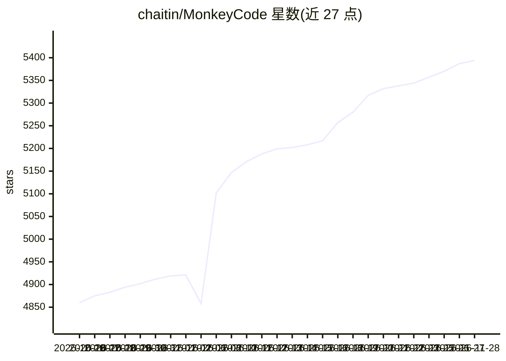

# chaitin/MonkeyCode

⭐ 5,394 · TypeScript · AGPL-3.0 · 推送 2026-11-27 · [GitHub](https://github.com/chaitin/MonkeyCode) · [官网](https://work.baizhi.cloud/) · 组织维护 · 中文 README

**面向团队的企业级开源 AI 办公工作台，AI 交付办公/编程/设计成果**

百智办公（MonkeyCode）是面向团队的开源 AI 办公工作台：用户用自然语言提出需求，由 AI 执行办公（PPT/文档/表格）、编程（架构设计/编码/修复）与设计（海报/交互/短剧）任务并交付结果。平台提供企业管理面板，支持团队共享大模型、知识库、技能、MCP 连接器与规则，含计费、权限控制与使用审计；支持一键脚本独立部署与 Docker Compose 源码部署，客户端覆盖 Windows/macOS/Linux/Web。免费版限 10 席位，付费版提供云电脑与技术支持。

## 筛选速览

| 维度 | 判定 | 备注 |
|---|---|---|
| AI 角色 | `ai-native` | 本体是模型或模型工具 |
| 许可风险 | `viral` | AGPL-3.0 |
| 部署形态 | `self-host` | docker 或自建部署 |
| 模型依赖 | — | README 未给出锁定关系 |
| 硬件要求 | — | 无带数字的原话,不猜 |
| 安装摩擦 | `low` | 无编译、无系统依赖或容器化 |
| 成熟度 | — | 结构信号不足 |

## 能力要点

- 覆盖办公、编程、设计三类任务，AI 直接交付工作成果
- 企业管理面板：资源共享、计费、权限控制与使用审计
- 一键脚本独立部署，数据保存在自有服务器
- 客户端支持 Windows/macOS/Linux/Web，Android/iOS 规划中

## 适用场景

- 团队私有化部署统一的 AI 办公工作台
- 用自然语言让 AI 生成汇报 PPT、整理表格数据
- 团队统一接入自有模型服务并按成员计费审计

## 场景标签

`AI 助手` `编码 Agent` `图像生成` `AI 写作` · 领域:编码与开发

## 证据(README 行号)

> L7: 百智办公是一款面向团队的开源 AI 办公工作台。用自然语言提出需求，让 AI 完成办公、编程与设计任务，直接交付工作成果。支持团队资源共享、统一管控与私有化部署。
> L47: |团队资源共享|在团队内共享大模型、知识库、技能、专家、MCP 连接器和规则，让成员复用已有资源。|

## 星数曲线

2026-10-26 4,860 → 2026-11-28 5,394（+534）

---
*卡片 v1 · prompt 1.4 · 生成 2026-11-24 · 置信度 high · 依据 README sha `bc8459b05c33` · [字段定义](../../DATASET.md)*
