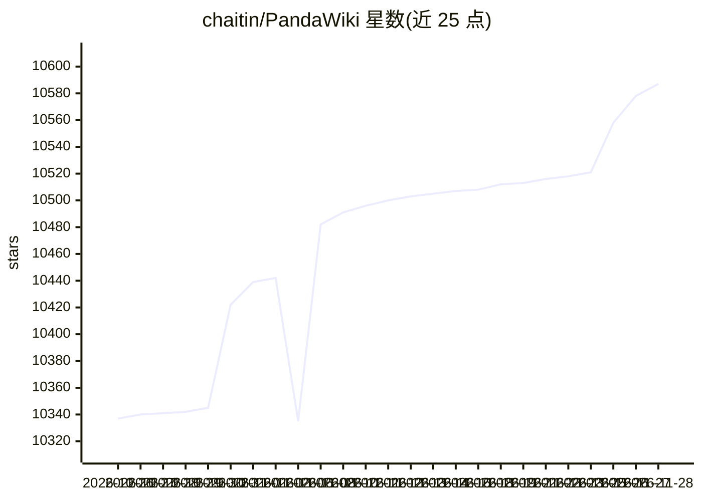

# chaitin/PandaWiki

⭐ 10,587 · TypeScript · AGPL-3.0 · 推送 2026-11-23 · [GitHub](https://github.com/chaitin/PandaWiki) · [官网](https://pandawiki.docs.baizhi.cloud/) · 组织维护 · 中文 README

**AI 大模型驱动的开源知识库/Wiki 搭建系统**

开源自托管知识库系统，用于构建产品文档、技术文档、FAQ 与博客站点，由维护方提供 SaaS 版本或 Docker 脚本自行部署。核心机制：知识库作为文档集合分别生成 Wiki 网站；AI 创作、AI 问答、AI 搜索功能需登录后配置大模型方可使用，可通过百智云模型广场一键接入或手动配置。支持 Markdown/HTML 富文本编辑，可导出 word/pdf 等格式，能从网页 URL、Sitemap、RSS、离线文件导入内容，并支持以网页挂件或钉钉/飞书/企业微信机器人形式集成。许可证为 AGPL-3.0，网络服务同样需开源。

## 筛选速览

| 维度 | 判定 | 备注 |
|---|---|---|
| AI 角色 | `ai-native` | 本体是模型或模型工具 |
| 许可风险 | `viral` | AGPL-3.0 |
| 部署形态 | `None` |  |
| 模型依赖 | — | README 未给出锁定关系 |
| 硬件要求 | — | 无带数字的原话,不猜 |
| 安装摩擦 | `low` | 无编译、无系统依赖或容器化 |
| 成熟度 | — | 结构信号不足 |

## 能力要点

- AI 辅助创作、问答、搜索（需先配置大模型）
- 支持网页 URL/Sitemap/RSS/离线文件导入内容
- 网页挂件与钉钉、飞书、企业微信机器人集成
- Docker 20.x+ 脚本安装，另提供 SaaS 版

## 适用场景

- 自托管搭建产品/技术文档站和 FAQ
- 把知识库做成机器人接入钉钉、飞书、企业微信
- 从已有网站或 RSS 源批量导入内容建 Wiki
- SaaS 在线体验知识库问答效果

## 场景标签

`文档问答` `知识库管理` · 领域:知识与检索

## 证据(README 行号)

> L10: PandaWiki 是一款 AI 大模型驱动的**开源知识库搭建系统**，帮助你快速构建智能化的 **产品文档、技术文档、FAQ、博客系统**，借助大模型的力量为你提供 **AI 创作、AI 问答、AI 搜索** 等能力。
> L58: > PandaWiki 是由 AI 大模型驱动的 Wiki 系统，在未配置大模型的情况下 AI 创作、AI 问答、AI 搜索 等功能无法正常使用。
> L21: - AI 驱动智能化：AI 辅助创作、AI 辅助问答、AI 辅助搜索。

## 星数曲线

2026-10-26 10,337 → 2026-11-28 10,587（+250）

---
*卡片 v1 · prompt 1.4 · 生成 2026-11-22 · 置信度 high · 依据 README sha `2a8ff607c497` · [字段定义](../../DATASET.md)*
