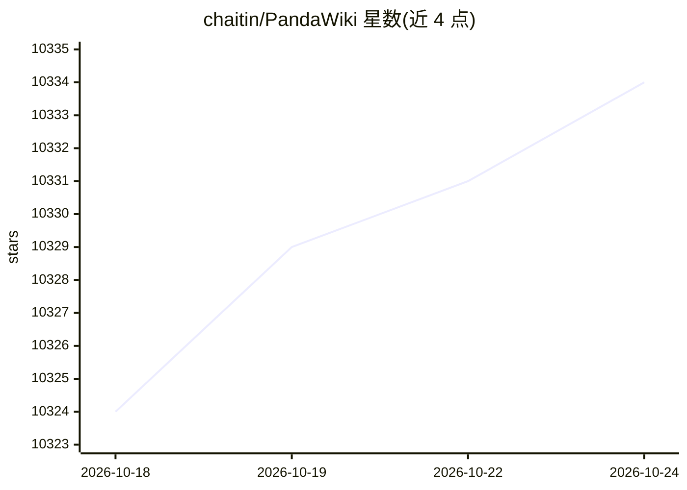

# chaitin/PandaWiki

⭐ 10,335 · TypeScript · AGPL-3.0 · 推送 2026-10-21 · [GitHub](https://github.com/chaitin/PandaWiki) · [官网](https://pandawiki.docs.baizhi.cloud/) · 组织维护 · 中文 README

**自托管的开源知识库/Wiki 搭建系统，提供 AI 创作、问答与搜索**

由长亭科技（Chaitin）开源的知识库搭建系统，用于构建产品文档、技术文档、FAQ 与博客网站。核心机制：基于知识库文档构建 Wiki 网站，由 AI 大模型驱动 AI 辅助创作、问答与搜索；未配置大模型时这些 AI 功能不可用，模型可通过一键配置或手动配置接入，推荐接入百智云模型广场。支持 Markdown/HTML 富文本编辑与多格式导出、网页挂件与钉钉/飞书/企业微信机器人集成、URL/Sitemap/RSS/离线文件导入内容。安装要求 Linux 系统、Docker 20.x 以上，通过 shell 脚本一键部署；另提供 SaaS 版本。采用 AGPL-3.0 许可证。

## 筛选速览

| 维度 | 判定 | 备注 |
|---|---|---|
| AI 角色 | `ai-native` | 本体是模型或模型工具 |
| 许可风险 | `viral` | AGPL-3.0 |
| 部署形态 | `None` |  |
| 模型依赖 | — | README 未给出锁定关系 |
| 硬件要求 | — | 无带数字的原话,不猜 |
| 安装摩擦 | `low` | 无编译、无系统依赖或容器化 |
| 成熟度 | — | 结构信号不足 |

## 能力要点

- AI 辅助创作、AI 问答、AI 搜索能力
- 知识库文档驱动生成 Wiki 网站
- 网页挂件与钉钉/飞书/企业微信机器人集成
- URL/Sitemap/RSS/离线文件多渠道内容导入

## 适用场景

- 搭建产品或技术文档站点并附 AI 问答
- 为团队建立自托管的 FAQ 与博客知识库
- 通过聊天机器人向第三方应用提供知识库问答

## 场景标签

`知识库管理` `文档问答` `聊天机器人` `AI 写作` · 领域:对话与助手

## 证据(README 行号)

> L6: PandaWiki 是一款 AI 大模型驱动的**开源知识库搭建系统**，帮助你快速构建智能化的 **产品文档、技术文档、FAQ、博客系统**，借助大模型的力量为你提供 **AI 创作、AI 问答、AI 搜索** 等能力。
> L17: - AI 驱动智能化：AI 辅助创作、AI 辅助问答、AI 辅助搜索。

## 星数曲线

2026-10-18 10,324 → 2026-10-24 10,334（+10）

---
*卡片 v1 · prompt 1.4 · 生成 2026-10-20 · 置信度 high · 依据 README sha `91d4b31c676a` · [字段定义](../../DATASET.md)*
