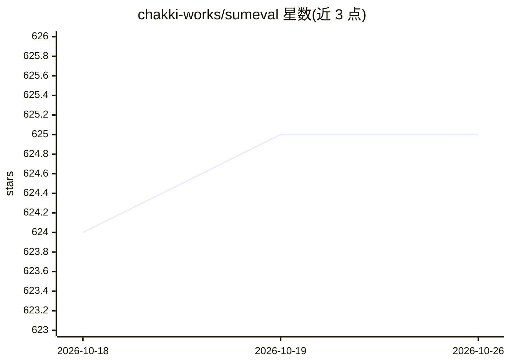

# chakki-works/sumeval

⭐ 625 · Python · Apache-2.0 · 推送 2026-04-13 · [GitHub](https://github.com/chakki-works/sumeval) · 组织维护

**多语言文本摘要评测框架：计算 ROUGE/BLEU 分数**

纯 Python 实现的文本摘要评测库，提供 ROUGE-X（经原版 Perl 脚本 ROUGE-1.5.5.pl 对照测试）与 BLEU（由 SacréBLEU 计算，与 WMT 官方脚本 mteval-v13a.pl 数值一致）分数计算，支持英语、日语、中文并可通过继承 BaseLang 扩展语言；带命令行工具支持字符串与文件输入。可选依赖包括 spaCy、janome/MeCab、jieba、GiNZA、pyhanlp 等，用于特定语言或 ROUGE-BE 计算。

## 筛选速览

| 维度 | 判定 | 备注 |
|---|---|---|
| AI 角色 | `ai-ecosystem` | LLM/agent 周边工具 |
| 许可风险 | `permissive` | Apache-2.0 |
| 部署形态 | `library` | 以包/库形式分发 |
| 模型依赖 | — | README 未给出锁定关系 |
| 硬件要求 | — | 无带数字的原话,不猜 |
| 安装摩擦 | `low` | 无编译、无系统依赖或容器化 |
| 成熟度 | — | 结构信号不足 |

## 能力要点

- ROUGE 分数与原版 Perl 脚本对照测试，BLEU 经 SacréBLEU 计算
- 支持英语/日语/中文，可继承 BaseLang 扩展语言
- 提供 CLI 工具，支持字符串与文件输入

## 适用场景

- 评测文本摘要或生成结果的 ROUGE/BLEU 分数
- 在多语言（英/日/中）项目中做摘要质量评测
- 通过 CLI 批量评测文件中的摘要

## 场景标签

`模型评测` · 领域:评测与运维

## 证据(README 行号)

> L1: Well tested & Multi-language
> L9:  * The ROUGE-X scores are tested compare with original Perl script (ROUGE-1.5.5.pl).

## 星数曲线

2026-10-18 624 → 2026-10-26 625（+1）

---
*卡片 v1 · prompt 1.4 · 生成 2026-10-21 · 置信度 high · 依据 README sha `0ada2fc22859` · [字段定义](../../DATASET.md)*
