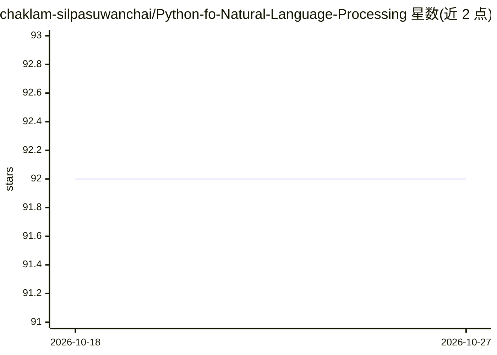

# chaklam-silpasuwanchai/Python-fo-Natural-Language-Processing

⭐ 92 · Jupyter Notebook · 推送 2026-03-21 · [GitHub](https://github.com/chaklam-silpasuwanchai/Python-fo-Natural-Language-Processing) · [官网](http://chaklam.com) · 组织维护

**AIT 自然语言处理课程的配套代码与讲义仓库**

亚洲理工学院（AIT）Natural Language Processing 课程的仓库，提供课程配套的 Google Slides 讲义与 YouTube 播放列表链接，以及按主题组织的代码/内容大纲：词向量（Word2Vec、GloVe）、NER、依存分析、seq2seq、LSTM/Transformer/BERT、spaCy、HuggingFace、RAG（Prompt/Chain/Tools/Agent）、多模态语言模型（ViT/CLIP/BLIP-2 等）与 RLHF（SFT/PPO/DPO）。内容改编自 CS224n、spaCy 课程、HuggingFace course 等公开资源，含学生贡献。README 未给出安装或运行命令。

## 筛选速览

| 维度 | 判定 | 备注 |
|---|---|---|
| AI 角色 | `ai-knowledge` | 知识聚合/清单类 |
| 许可风险 | `none` | — |
| 部署形态 | `None` |  |
| 模型依赖 | — | README 未给出锁定关系 |
| 硬件要求 | — | 无带数字的原话,不猜 |
| 安装摩擦 | `low` | 无编译、无系统依赖或容器化 |
| 成熟度 | — | 结构信号不足 |

## 能力要点

- 课程讲义（Google Slides）与 YouTube 播放列表公开链接
- 大纲覆盖词向量、Transformer/BERT、spaCy、HuggingFace、RAG、多模态与 RLHF
- 汇总 CS224n、spaCy 课程等外部学习资源与致谢

## 适用场景

- 跟随课程系统学习 NLP 从基础到 RAG/RLHF 的内容
- 获取 NLP 各主题的代码示例与外部学习资源清单

## 场景标签

`教程课程` · 领域:学习与行业

## 证据(README 行号)

> L3: This is the repository for the Natural Language Processing course at the Asian Institute of Technology.
> L41: 1. Fundamentals

## 星数曲线

2026-10-18 92 → 2026-10-27 92（+0）

---
*卡片 v1 · prompt 1.4 · 生成 2026-10-23 · 置信度 high · 依据 README sha `69c06475adc3` · [字段定义](../../DATASET.md)*
