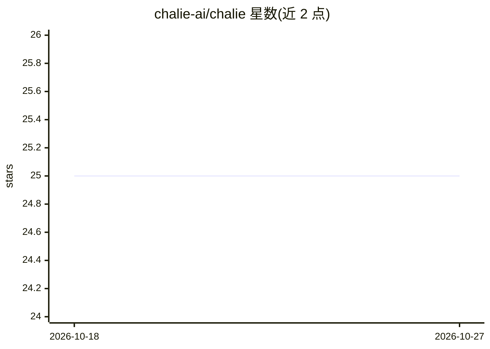

# chalie-ai/chalie

⭐ 25 · Python · NOASSERTION · 推送 2026-10-26 · [GitHub](https://github.com/chalie-ai/chalie) · [官网](https://chalie.ai) · 组织维护

**本地自托管的个人 AI 助理：长期记忆、代理行动**

开源的个人 AI，运行在用户自己的机器上，由用户选择的模型驱动（Anthropic、Gemini、OpenAI 等 20 家供应商，或 Ollama 全本地运行）。以单个 Python 进程加 SQLite（含 sqlite-vec/FTS5）实现自管理记忆、目标驱动的后台研究、视觉识别、浏览器自动化、IMAP/CalDAV 连接、本地语音（Moonshine STT + Kokoro TTS，ONNX）与 MCP 双向连接。行动受 Allow/Ask/Deny 策略门控，凭据静态加密、零遥测。支持 macOS Apple Silicon 与 Linux，需 Python 3.11+、约 2GB RAM；README 自称 Beta 阶段。

## 筛选速览

| 维度 | 判定 | 备注 |
|---|---|---|
| AI 角色 | `ai-native` | 本体是模型或模型工具 |
| 许可风险 | `none` | NOASSERTION |
| 部署形态 | `self-host` | docker 或自建部署 |
| 模型依赖 | local-ok | 支持本地模型 |
| 硬件要求 | — | 无带数字的原话,不猜 |
| 安装摩擦 | `low` | 无编译、无系统依赖或容器化 |
| 成熟度 | `idea` | |

## 能力要点

- Allow/Ask/Deny 三级行动门控策略
- 后台自管理记忆：对话蒸馏为持久事实并自动召回
- MCP 双向连接：既接入远程 MCP 服务器也对外暴露工具
- 本地语音链路（Moonshine STT + Kokoro TTS，ONNX），无云端转录

## 适用场景

- 让 AI 在本机后台持续处理个人事务并按规则征求许可
- 接入自己的邮箱、日历、联系人做个人助理
- 全程不出本网的本地化个人 AI（配合 Ollama）

## 场景标签

`AI 助手` `Agent 记忆` `浏览器自动化` · 领域:Agent 开发

## 证据(README 行号)

> L6:  An open-source personal AI that runs on your own machine — it remembers what matters, works while you're away, and 
> L26: Most AI tools forget you the moment you close the tab. Chalie runs on your own machine as a **reasoning engine that
> L32: |🧠 **Self-managing memory**|A background pass distills conversation into durable facts and remembered moments — rec

## 星数曲线

2026-10-18 25 → 2026-10-27 25（+0）

---
*卡片 v1 · prompt 1.4 · 生成 2026-10-27 · 置信度 mid · 依据 README sha `7e8e86a49ed3` · [字段定义](../../DATASET.md)*
