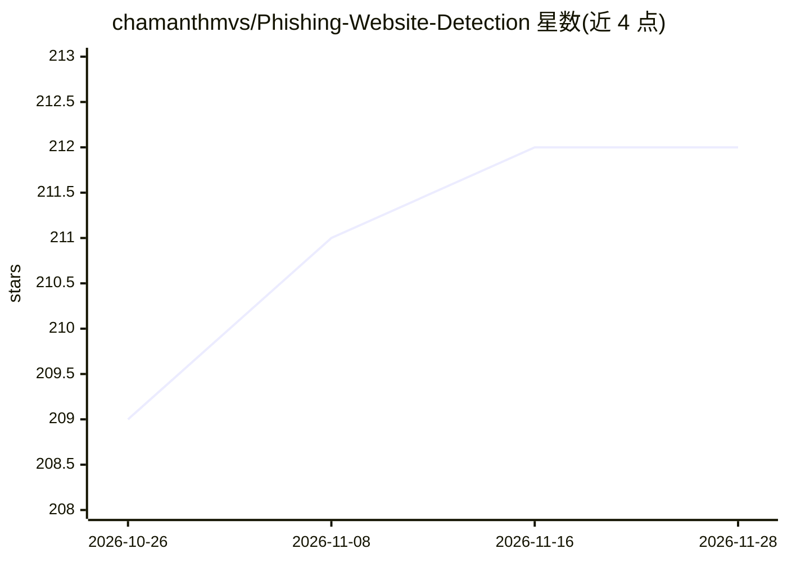

# chamanthmvs/Phishing-Website-Detection

⭐ 212 · Jupyter Notebook · MIT · 推送 2026-11-08 · [GitHub](https://github.com/chamanthmvs/Phishing-Website-Detection) · [官网](https://chamanthmvs.github.io/Phishing-Website-Detection/) · 个人维护

**机器学习 URL 分类服务：识别钓鱼网站链接**

基于 URL 词法特征的钓鱼网站检测项目，由两个解耦服务组成：FastAPI 后端负责从 URL 字符串计算 20 个词法特征（不访问目标网站）并承载三个训练模型（Random Forest、Histogram Gradient Boosting、Logistic Regression），最优者作为 API 默认；Next.js 前端仅通过 JSON API 请求预测。训练完全离线可复现。定位为学习与安全研究用途的启发式工具，预测结果非安全保证。

## 筛选速览

| 维度 | 判定 | 备注 |
|---|---|---|
| AI 角色 | `ai-native` | 本体是模型或模型工具 |
| 许可风险 | `permissive` | MIT |
| 部署形态 | `library` | 以包/库形式分发 |
| 模型依赖 | — | README 未给出锁定关系 |
| 硬件要求 | — | 无带数字的原话,不猜 |
| 安装摩擦 | `low` | 无编译、无系统依赖或容器化 |
| 成熟度 | — | 结构信号不足 |

## 能力要点

- 20 个纯词法 URL 特征，扫描时不请求目标网站
- 三个模型对比训练，最优者作为 API 默认服务
- 前后端解耦，前端无模型无 Python 依赖

## 适用场景

- 批量筛查 URL 是否疑似钓鱼链接
- 作为机器学习分类项目的学习参考
- 安全研究中复现离线可复现的训练流程

## 场景标签

`网络安全` · 领域:学习与行业

## 证据(README 行号)

> L3: Phishing Website Detection classifies URLs as **legitimate** or **potentially
> L49: Three models are trained and compared on a held-out 25% test set (2,553 URLs;

## 星数曲线

2026-10-26 209 → 2026-11-28 212（+3）

---
*卡片 v1 · prompt 1.4 · 生成 2026-11-25 · 置信度 high · 依据 README sha `1b62d7910cf5` · [字段定义](../../DATASET.md)*
