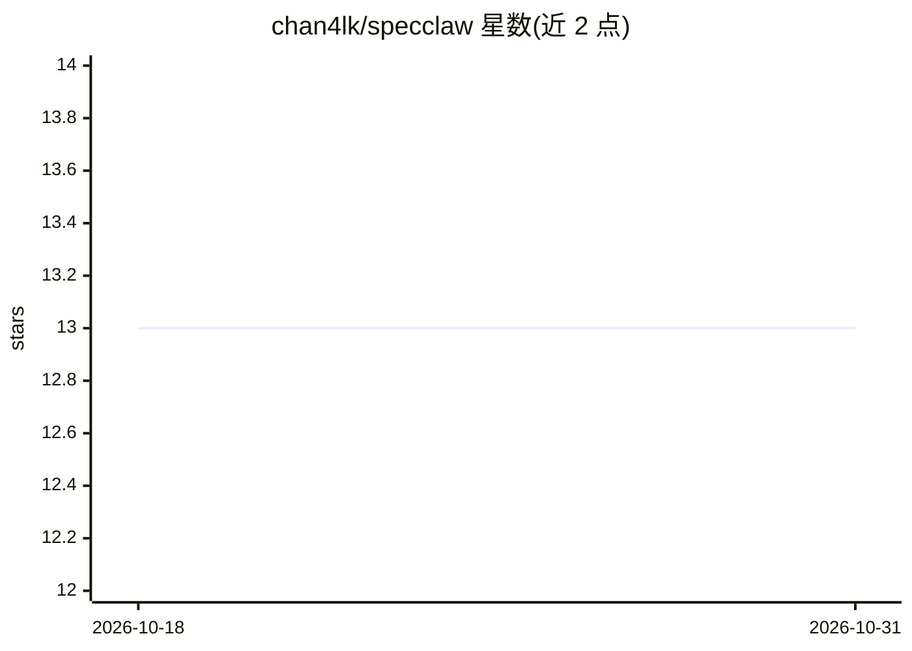

# chan4lk/specclaw

⭐ 13 · Shell · MIT · 推送 2026-10-29 · [GitHub](https://github.com/chan4lk/specclaw) · [官网](https://chan4lk.github.io/specclaw/) · 个人维护

**面向 Claude Code/Codex 的规格驱动开发插件工作流**

以 Claude Code 与 Codex 插件形式提供的规格驱动开发（spec-driven development）工作流：用户说 "I have a proposal" 后，框架将想法依次推进 propose→plan→build→verify→pr 直至合并为可投产代码，并在仓库内保留变更轨迹。每次变更先生成可在浏览器打开的 HTML mock，代码编写前即可预览结果。同市场含四个插件（核心生命周期、遗留系统重建、GitHub/Jira/Azure DevOps 同步、附加工具），共享同一版本号。

## 筛选速览

| 维度 | 判定 | 备注 |
|---|---|---|
| AI 角色 | `ai-ecosystem` | LLM/agent 周边工具 |
| 许可风险 | `permissive` | MIT |
| 部署形态 | `None` |  |
| 模型依赖 | locked-api |  |
| 硬件要求 | — | 无带数字的原话,不猜 |
| 安装摩擦 | `low` | 无编译、无系统依赖或容器化 |
| 成熟度 | — | 结构信号不足 |

## 能力要点

- propose→plan→build→verify→pr 全自动 SDLC 流水线
- 每次变更先产出可浏览器预览的 HTML mock
- 四个可按需安装的插件共享同一版本
- lean/full 两种流程，每变更单文件记录

## 适用场景

- 用自然语言提案驱动从想法到 PR 的完整开发流程
- 先看低保真 mock 再决定是否写代码
- 把 GitHub issues/Jira/Azure DevOps 与开发流程同步

## 场景标签

`代码生成` `编码 Agent` · 领域:编码与开发

## 证据(README 行号)

> L5: **Spec-driven development for Claude Code and Codex.** Turn a plain-English idea into merged, production-ready code 
> L22: Requires Claude Code v2.1 or later.
> L33: |`specclaw`|The lifecycle: init, propose, plan, build, verify, pr, status, archive|`/plugin install specclaw@chan4l

## 星数曲线

2026-10-18 13 → 2026-10-31 13（+0）

---
*卡片 v1 · prompt 1.4 · 生成 2026-10-31 · 置信度 high · 依据 README sha `2cc47ea63bd9` · [字段定义](../../DATASET.md)*
