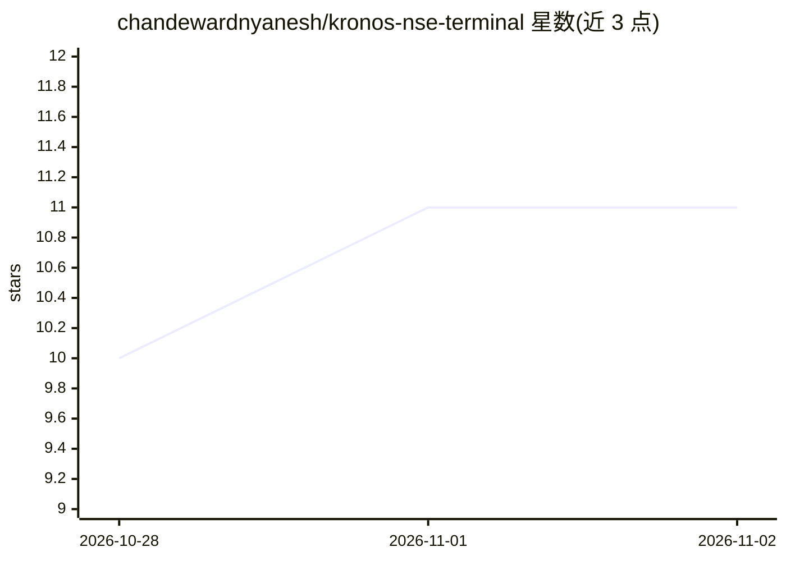

# chandewardnyanesh/kronos-nse-terminal

⭐ 11 · Python · 推送 2026-05-31 · [GitHub](https://github.com/chandewardnyanesh/kronos-nse-terminal) · 个人维护

**在 NSE/BSE 实时数据上运行 Kronos 模型做 K 线预测的 Python 交易终端**

基于 Flask 的印度股市交易终端，将 Kronos 金融基础模型（AAAI 2026 录用，4.1M–102.3M 三个规格）应用于 NSE/BSE 实时数据，输出全天 5 分钟 K 线预测与多样本置信带。数据源采用 yfinance 主源 + Zerodha Kite 备份的双通道架构，内置 EMA/VWAP/RSI 等 7 类技术指标、结构化交易信号引擎与 walk-forward 回测（Sharpe、最大回撤、P&L）。推理为异步作业（CPU 推理 1–5 分钟），并支持 MCP 服务器集成，使预测可作为 Claude 工具调用。声明仅供教育与研究用途，非投资建议。

## 筛选速览

| 维度 | 判定 | 备注 |
|---|---|---|
| AI 角色 | `ai-native` | 本体是模型或模型工具 |
| 许可风险 | `none` | — |
| 部署形态 | `self-host` | docker 或自建部署 |
| 模型依赖 | — | README 未给出锁定关系 |
| 硬件要求 | — | 无带数字的原话,不猜 |
| 安装摩擦 | `low` | 无编译、无系统依赖或容器化 |
| 成熟度 | — | 结构信号不足 |

## 能力要点

- Kronos 多样本推理生成预测置信带（5th/95th 百分位）
- yfinance 主源 + Zerodha Kite 实时备份的双数据源架构
- walk-forward 回测框架（Sharpe / 最大回撤 / P&L 模拟）
- MCP server 集成：预测可作为 Claude 工具调用

## 适用场景

- 查看 NSE/BSE 个股的全天 K 线 AI 预测与技术指标
- 对交易信号做带交易成本的 walk-forward 回测
- 通过 Claude 工具调用以对话方式获取预测分析

## 场景标签

`金融量化` · 领域:学习与行业

## 证据(README 行号)

> L14: A production-quality trading terminal that runs the Kronos foundation model (accepted AAAI 2026, trained on 45+ glo
> L42: ### Kronos AI Forecasting

## 星数曲线

2026-10-28 10 → 2026-11-02 11（+1）

---
*卡片 v1 · prompt 1.4 · 生成 2026-11-02 · 置信度 high · 依据 README sha `8c1f6a124d5c` · [字段定义](../../DATASET.md)*
