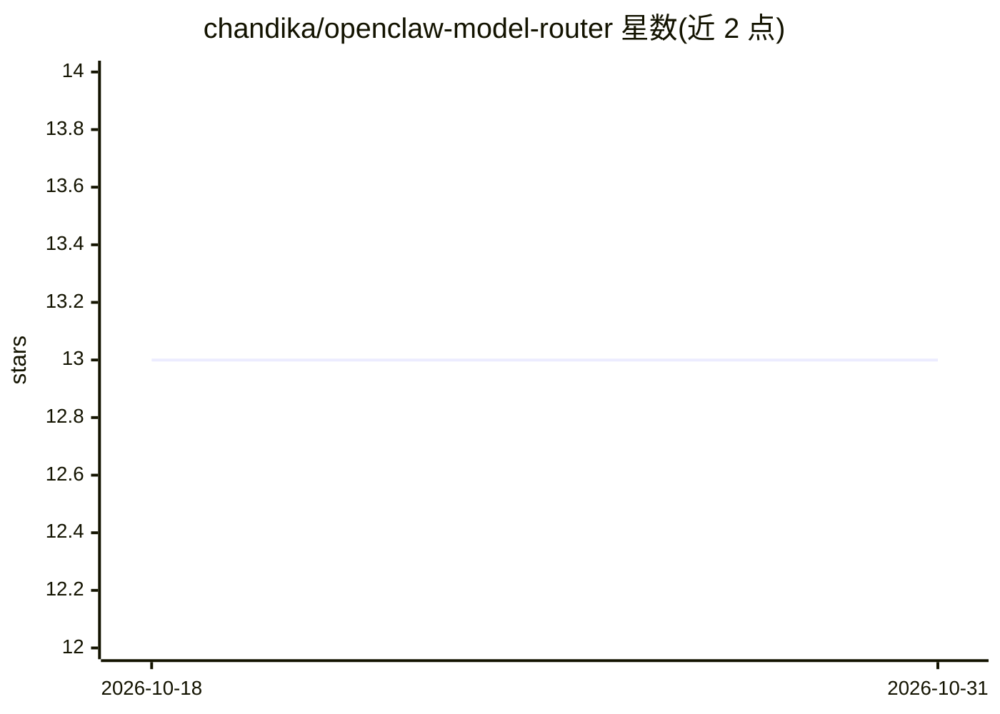

# chandika/openclaw-model-router

⭐ 13 · MIT · 推送 2026-02-18 · [GitHub](https://github.com/chandika/openclaw-model-router) · 个人维护

**OpenClaw 的自学习多供应商模型路由技能**

以 OpenClaw 技能（SKILL.md）形式提供的模型路由配置器：自动检测已配置的供应商与模型，维护含基准分数、定价与路由规则的 model-registry.json；新增模型时自动抓取其 model card 与基准数据并建议插入位置，移除模型时重路由相关任务。提供 Performance/Balanced/Economy 三种模式与按任务的硬路由规则（如 computer use 固定走 Claude、深度推理固定走 Opus），并支持“work harder / save money”等触发词在模式间切换。

## 筛选速览

| 维度 | 判定 | 备注 |
|---|---|---|
| AI 角色 | `ai-ecosystem` | LLM/agent 周边工具 |
| 许可风险 | `permissive` | MIT |
| 部署形态 | `None` |  |
| 模型依赖 | — | README 未给出锁定关系 |
| 硬件要求 | — | 无带数字的原话,不猜 |
| 安装摩擦 | `low` | 无编译、无系统依赖或容器化 |
| 成熟度 | — | 结构信号不足 |

## 能力要点

- 自动检测与发现新增模型，经 web search 抓取基准数据后更新路由
- Performance / Balanced / Economy 三档模式
- 按任务的硬路由表（computer use→Claude、深度推理→Opus 等）
- 触发词驱动的模式切换与会话级覆盖

## 适用场景

- 为 OpenClaw 多供应商环境自动生成模型路由配置
- 新增模型后自动评估其适配位置并建议路由调整
- 在质量与成本之间按会话切换路由模式

## 场景标签

`模型网关` · 领域:Agent 开发

## 证据(README 行号)

> L3: Self-learning multi-provider model routing. Auto-detects your available models, discovers new ones when you add them
> L17: 1. **Detects** which providers and models you have configured

## 星数曲线

2026-10-18 13 → 2026-10-31 13（+0）

---
*卡片 v1 · prompt 1.4 · 生成 2026-10-31 · 置信度 high · 依据 README sha `e4a211d6e219` · [字段定义](../../DATASET.md)*
