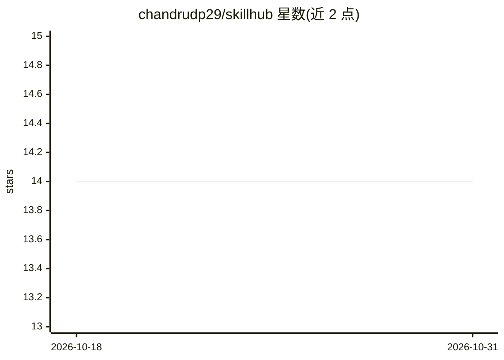

# chandrudp29/skillhub

⭐ 14 · Python · MIT · 推送 2026-07-03 · [GitHub](https://github.com/chandrudp29/skillhub) · [官网](https://pypi.org/project/skillhub-ai/) · 个人维护

**AI agent 技能的包管理器：跨 13 个生态安装、合并技能**

面向使用 Claude Code、Cursor、Codex、Gemini CLI 等编码 agent 的开发者，以 pip 安装的 CLI 工具：将 Anthropic、OpenAI、GitHub Copilot、Microsoft、Google 等 13 个生态的技能统一为 SKILL.md 格式，通过 skillhub.json 清单记录并复现安装；提供 2-10 个技能合并（compose）、跨技能去重以降低 token 用量（optimize）、AGENTS.md 与 SKILL.md 双向转换（bridge）、技能对比（diff）等命令。冲突合并可选 --strategy ai，经 Anthropic API 调用 Claude 处理（需 pip 安装 [ai] 扩展并设置 API key），默认策略为 first-wins。

## 筛选速览

| 维度 | 判定 | 备注 |
|---|---|---|
| AI 角色 | `ai-ecosystem` | LLM/agent 周边工具 |
| 许可风险 | `permissive` | MIT |
| 部署形态 | `self-host` | docker 或自建部署 |
| 模型依赖 | — | README 未给出锁定关系 |
| 硬件要求 | — | 无带数字的原话,不猜 |
| 安装摩擦 | `low` | 无编译、无系统依赖或容器化 |
| 成熟度 | — | 结构信号不足 |

## 能力要点

- skillhub.json 清单实现团队可复现的技能安装
- 合并 2-10 个技能并检测冲突，AI 策略可调用 Claude 生成合并版本
- AGENTS.md ↔ SKILL.md 双向桥接，支持 Claude Code/Cursor/Codex/Gemini 四种 agent
- optimize 跨技能去重，按 README 声明降低 10-30% token 用量

## 适用场景

- 在 Claude Code、Cursor、Codex、Gemini CLI 间共享同一套技能
- 把多个技能合并为一个专家技能并解决章节冲突
- 团队通过提交 skillhub.json 复现统一的技能配置
- 减少多技能加载造成的 token 消耗

## 场景标签

`提示工程` · 领域:Agent 开发

## 证据(README 行号)

> L3:  The package manager for AI agent skills.
> L72: Claude Code (`.claude/commands/`), Cursor (`.cursor/rules/`), OpenAI Codex (`AGENTS.md`), Gemini CLI (`.gemini/skil

## 星数曲线

2026-10-18 14 → 2026-10-31 14（+0）

---
*卡片 v1 · prompt 1.4 · 生成 2026-10-31 · 置信度 mid · 依据 README sha `2c96471ef9b4` · [字段定义](../../DATASET.md)*
