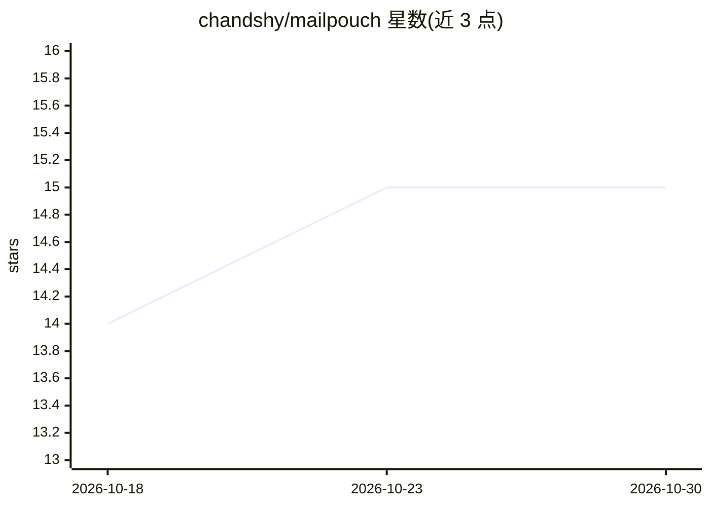

# chandshy/mailpouch

⭐ 15 · TypeScript · MIT · 推送 2026-10-26 · [GitHub](https://github.com/chandshy/mailpouch) · [官网](https://www.npmjs.com/package/mailpouch) · 个人维护

**让 AI agent 在权限管控下访问 Proton Mail 的本地 MCP 服务器**

面向 Proton Mail（经 Proton Bridge）与普通 IMAP 的本地 MCP 服务器，向 AI agent 暴露最多 86 个类型化工具，覆盖读取、发送、草稿、文件夹、搜索、分析与定时邮件。核心机制：默认只读的 5 档权限预设、破坏性操作经 MCP elicitation 人工确认、按客户端的授权与速率限制、OAuth 2.1 与 PKCE 认证、本地 FTS5 全文索引。需 Node.js ≥22、运行中的 Proton Bridge（付费 Proton 套餐）；自述为非官方工具，Proton ToS §2.10 对自动化访问有禁止条款。支持 macOS/Windows/Linux。

## 筛选速览

| 维度 | 判定 | 备注 |
|---|---|---|
| AI 角色 | `ai-ecosystem` | LLM/agent 周边工具 |
| 许可风险 | `permissive` | MIT |
| 部署形态 | `desktop` | 安装包/桌面程序 |
| 模型依赖 | — | README 未给出锁定关系 |
| 硬件要求 | — | 无带数字的原话,不猜 |
| 安装摩擦 | `low` | 无编译、无系统依赖或容器化 |
| 成熟度 | — | 结构信号不足 |

## 能力要点

- 最多 86 个工具（83 个常规 + 3 个元工具），覆盖 11 个类别
- 默认只读权限，破坏性操作需人工确认，agent 不能自行提权
- 本地运行，经 TLS 连接 Proton Bridge，本地 FTS5+BM25 索引
- 每个客户端独立授权：文件夹白名单、IP 绑定、按工具限速、过期与账户绑定

## 适用场景

- 让 Claude 等 MCP 客户端帮我摘要、搜索、整理收件箱
- 在受控权限下让 AI 代写并定时发送邮件
- 为不同 agent 设置不同的邮箱访问范围与限速

## 场景标签

`AI 写作` · 领域:内容生成

## 证据(README 行号)

> L3: `mailpouch` is an MCP server that gives AI agents a typed, permission-gated, audit-logged tool surface over private-
> L38: Proton Mail encrypts your email end-to-end, which means no third-party API can read it. Proton Bridge solves this b

## 星数曲线

2026-10-18 14 → 2026-10-30 15（+1）

---
*卡片 v1 · prompt 1.4 · 生成 2026-10-30 · 置信度 high · 依据 README sha `0fb0d189012f` · [字段定义](../../DATASET.md)*
