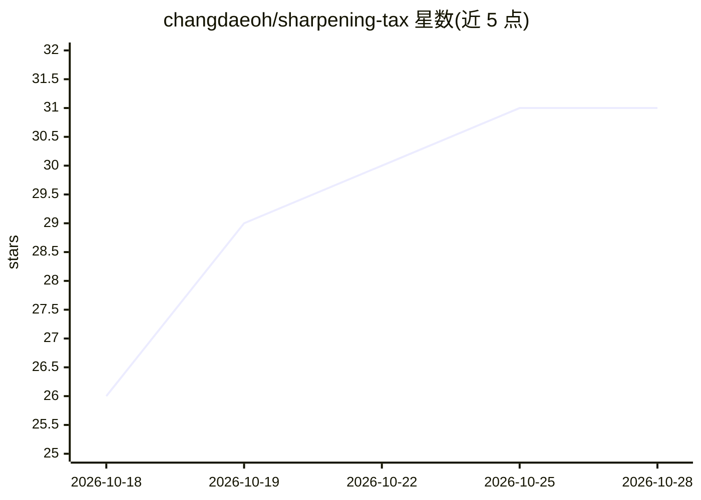

# changdaeoh/sharpening-tax

⭐ 31 · Python · NOASSERTION · 推送 2026-10-02 · [GitHub](https://github.com/changdaeoh/sharpening-tax) · [官网](https://changdaeoh.github.io/sharpening-tax/) · 组织维护

**论文代码：度量 RL 后训练中损失的测试时可扩展性（Sharpening Tax）**

论文 'Sharpening Tax in Post-Training' 的官方代码库。研究比较 14 对开源基座/后训练模型在三个 agentic 基准（BFCL v4 multi-turn、WebShop、ACEBench，每任务 128 rollouts）上的表现，提出诊断指标 Sharpening Tax 度量后训练损失的测试时可扩展性，以及 PTGS（后验温度化组采样）RL 训练方法。仓库提供文本 harness、rollout 运行器、指标实现、示例数据与 PTGS 控制器；明确声明非复现包，基准环境与 RL 训练基础设施需自备。指标与 PTGS 在 CPU 上以 numpy 运行，附带 70 个测试。许可为 CC BY-NC 4.0。

## 筛选速览

| 维度 | 判定 | 备注 |
|---|---|---|
| AI 角色 | `ai-ecosystem` | LLM/agent 周边工具 |
| 许可风险 | `none` | NOASSERTION |
| 部署形态 | `library` | 以包/库形式分发 |
| 模型依赖 | — | README 未给出锁定关系 |
| 硬件要求 | — | 无带数字的原话,不猜 |
| 安装摩擦 | `low` | 无编译、无系统依赖或容器化 |
| 成熟度 | — | 结构信号不足 |

## 能力要点

- Sharpening Tax 诊断指标：pass@k 视角下后训练损失的可扩展性
- PTGS：按贝叶斯难度估计设定 rollout 温度，用于 RL 训练
- 14 对基座/后训练模型 × 3 基准的示例结果数据（128 rollouts/任务）
- 指标与 PTGS 在 CPU 上以 numpy 运行，含 70 个测试

## 适用场景

- 复现论文指标或在自己的 rollout 数据上计算 Sharpening Tax
- 在 RL 训练器中集成 PTGS 采样策略
- 研究基座模型 vs 后训练模型的 agentic 能力差异

## 场景标签

`模型评测` `强化学习` · 领域:评测与运维

## 证据(README 行号)

> L25: **sharpen** behaviors its base model already has? We compare 14 open base/post-trained
> L33: - **Sharpening Tax.** A diagnostic metric for the test-time scalability lost in post-training.
> L36: - **PTGS.** Posterior-tempered group sampling sets each prompt's rollout temperature from a
> L42: This repository provides minimal working examples for understanding the project; it is not a

## 星数曲线

2026-10-18 26 → 2026-10-28 31（+5）

---
*卡片 v1 · prompt 1.4 · 生成 2026-10-26 · 置信度 high · 依据 README sha `f258ed3c45b2` · [字段定义](../../DATASET.md)*
